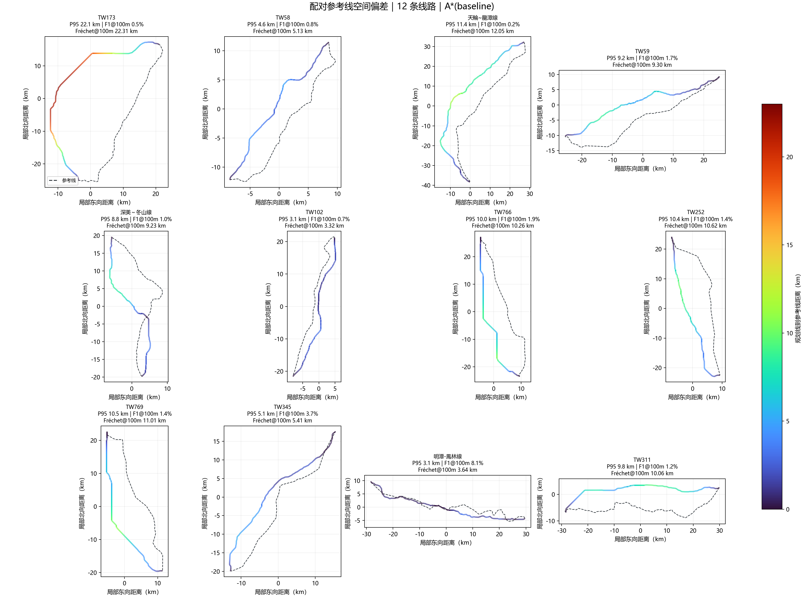

# V5 无线路先验真实线路空间偏差复核（2026-10-25）

> 本次为同一次 12 条线路批量运行。历史线路中线只在 A* 路线选定后用于事后评分；起终点来自 `real_cases.csv` 的历史线路端点，因此不是盲选站点测试。此评估衡量地图形状相似度，不等于工程可行性认证。

## 结果

- 12/12 条规划完成，0 条失败、0 条无路；12 条的 OSM 建筑和用地图层状态均为 `available`，但 OSM 覆盖完整性仍未核实。
- 规划采用 35 m 台湾 DEM + 地形代价 + ARDSWC 灾害图层 + OSM 建筑/用地代理层；A* 基线，无 VIN/PPO，无历史线路中线引导。
- 较差方向、长度加权 P95 的线路间中位数 **9.47 km**（均值 8.99 km）。
- F1@100m 中位数 **1.30%**；只有 1/12 条 F1@100m 达到 5%。F1 是双向线路长度覆盖率诊断，不是“误差百分比”。
- 长度误差中位数 3.08%，但空间偏差仍很大；长度接近不能代表走向贴近。
- 当前不满足“与真实线路极度贴近”，也不能称为工程上最优或工程可行。加载顺序修复消除了 TW173 建筑缓存缺层，但没有改善路线偏差。

## 误差图

彩色规划线段表示到参考线的最近距离，虚线为参考线。P95 取两个方向中较大的长度加权 95 分位数；F1@100m 是两个方向覆盖率的调和平均。

逐线路误差图：

- [TW173：P95 22.08 km，F1@100m 0.46%](figures/v5_real_recheck_20261025/TW173_error_map.png)
- [TW58：P95 4.57 km，F1@100m 0.78%](figures/v5_real_recheck_20261025/TW58_error_map.png)
- [天輪~龍潭線：P95 11.41 km，F1@100m 0.22%](figures/v5_real_recheck_20261025/天輪_龍潭線_error_map.png)
- [TW59：P95 9.16 km，F1@100m 1.72%](figures/v5_real_recheck_20261025/TW59_error_map.png)
- [深美～冬山線：P95 8.76 km，F1@100m 0.99%](figures/v5_real_recheck_20261025/深美_冬山線_error_map.png)
- [TW102：P95 3.05 km，F1@100m 0.74%](figures/v5_real_recheck_20261025/TW102_error_map.png)
- [TW766：P95 10.01 km，F1@100m 1.89%](figures/v5_real_recheck_20261025/TW766_error_map.png)
- [TW252：P95 10.43 km，F1@100m 1.39%](figures/v5_real_recheck_20261025/TW252_error_map.png)
- [TW769：P95 10.51 km，F1@100m 1.36%](figures/v5_real_recheck_20261025/TW769_error_map.png)
- [TW345：P95 5.09 km，F1@100m 3.70%](figures/v5_real_recheck_20261025/TW345_error_map.png)
- [明潭-鳳林線：P95 3.06 km，F1@100m 8.15%](figures/v5_real_recheck_20261025/明潭-鳳林線_error_map.png)
- [TW311：P95 9.79 km，F1@100m 1.24%](figures/v5_real_recheck_20261025/TW311_error_map.png)

## 逐线路指标

| 线路 | 较差方向 P95 (km) | F1@100m | F1@1km | 长度误差 |
|---|---:|---:|---:|---:|
| TW173 | 22.08 | 0.46% | 3.42% | 26.10% |
| TW58 | 4.57 | 0.78% | 7.79% | 4.65% |
| 天輪~龍潭線 | 11.41 | 0.22% | 5.28% | 17.29% |
| TW59 | 9.16 | 1.72% | 16.08% | 0.33% |
| 深美～冬山線 | 8.76 | 0.99% | 9.15% | 3.89% |
| TW102 | 3.05 | 0.74% | 7.01% | 2.44% |
| TW766 | 10.01 | 1.89% | 6.87% | 1.45% |
| TW252 | 10.43 | 1.39% | 10.26% | 0.61% |
| TW769 | 10.51 | 1.36% | 6.26% | 1.30% |
| TW345 | 5.09 | 3.70% | 19.27% | 0.36% |
| 明潭-鳳林線 | 3.06 | 8.15% | 58.64% | 3.72% |
| TW311 | 9.79 | 1.24% | 6.61% | 9.53% |

## 复现与限制

- 完整命令、DEM/OSM/灾害输入哈希、运行时源码哈希和逐线路文件 SHA-256 见 `evidence/v5_real_recheck_20261025/`。运行 provenance 记录的 23 个运行时代码文件 SHA-256 已逐一与本次运行源码核对一致；提交后内容不变，可据哈希复现。
- 修复前的 12 线批次曾在 TW173 首次读建筑缓存时遇到 `MemoryError`，空约束继续规划；本次先加载 OSM 图层，并在建筑/用地 `read_error` 时将案例记为失败，因此 TW173 与其他线路均用同类图层状态完成。
- 真实参考几何不属于规划输入；任务 CSV 中的起终点源自历史线路记录。各参考线路长度都完整落在规划窗口内。
- 建筑、用地只有 `available`/`features_observed` 表示缓存读成功且观测到要素，不证明覆盖完整；数据可能漏标。缺少经过核验的保护区、人口/聚落完整数据、塔位、档距、弧垂净空、跨越许可、导线与电气设计约束。
- 目前与历史线路的偏差不能通过继续拟合历史中线解决，因为规划需保持无线路先验。下一步应接入经核验的工程/约束数据，并用独立站点任务做约束消融与工程可行性复核。
