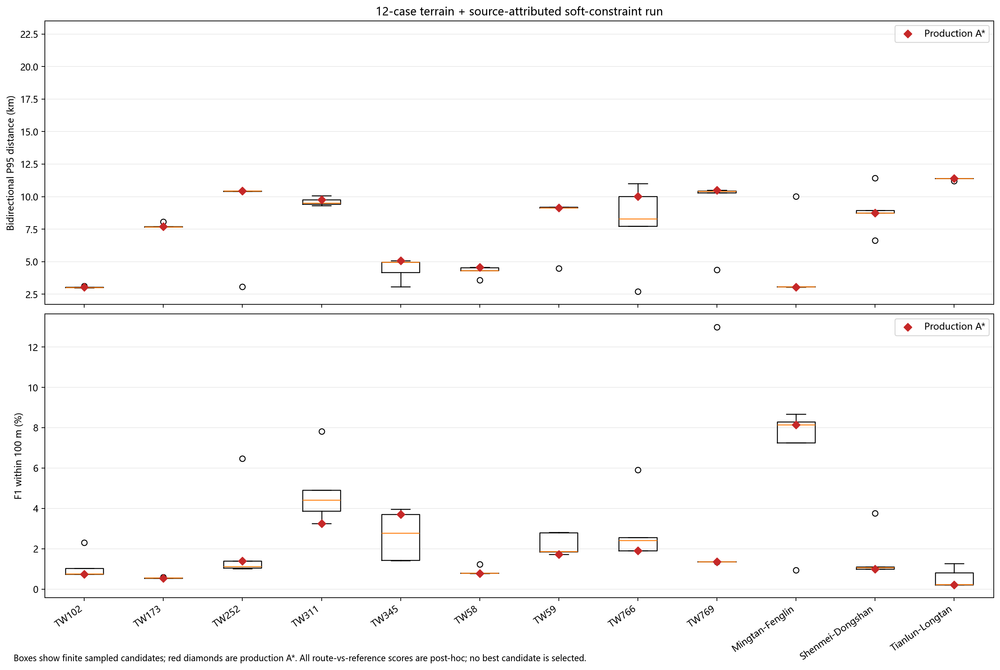
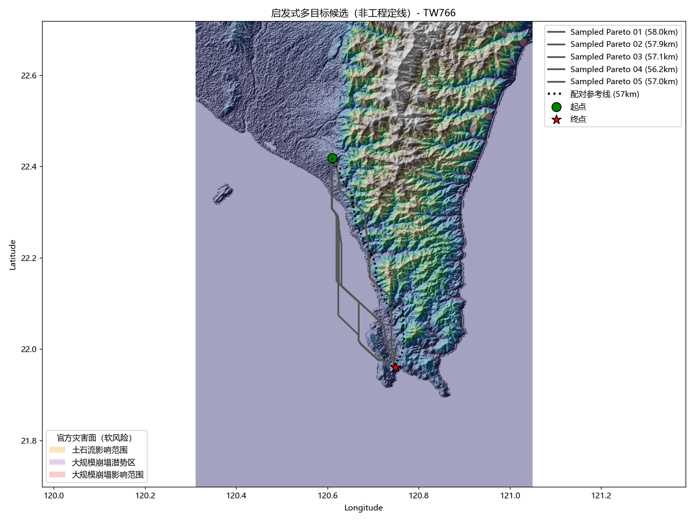
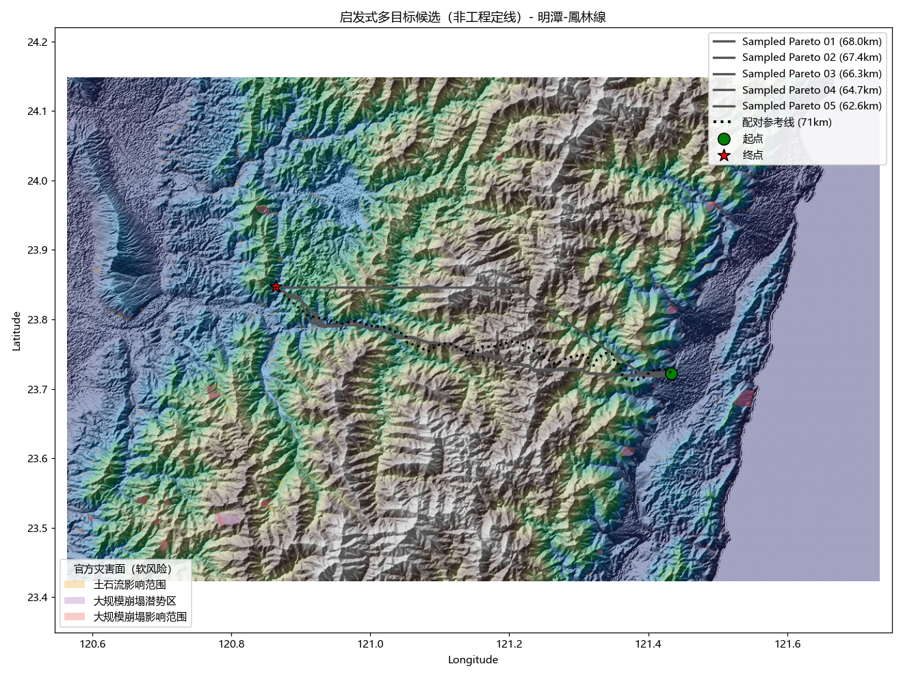

# 12 线路地形与软约束 A* 采样候选复测

复测日期：2026-10-25。此次复测比较生产 A* 与同一代价面上的有限权重采样候选。12 条参考线只在各案例规划路线和候选冻结后用于事后空间评估；参考线不参与候选生成、参数调整或最终路线选择。

## 结论

这次实验**没有证明采样候选能稳定改善规划结果**，因此生产路线仍采用 A*(baseline)，没有把事后得分较好的候选升为最终路线。

在 12 条案例中，每条线路都生成 5 个采样候选。以每例 5 个候选的指标中位数作为描述性统计，跨案例双向 P95 中位数为 **8.529 km**，生产 A* 为 **8.959 km**；但 100 m 双向 F1 中位数为 **1.247%**，低于生产 A* 的 **1.372%**。候选中位 P95 在 7/12 条线路更低，候选中位 F1@100m 在 9/12 条更高。不同指标并未一致改善，且候选没有运营选路规则。

12/12 案例完成，0 条无路、0 条失败；规划和图件生成耗时 **2,278.5 秒（约 38 分钟）**。有限采样增加了路线候选，但不是完整 Pareto 前沿，也没有验证杆塔、档距、导线净空或许可可行性。

## 配置与输入边界

| 项目 | 本次设置及边界 |
| --- | --- |
| 规划器 | 默认确定性 A*，`astar_heuristic_weight=1.0`；未运行 VIN/PPO；额外生成 5 个有限权重 Sampled Pareto 诊断候选 |
| 地形 | 35 m 级 DEM，实际窗口像元约 34.8–35.0 m；来源为 Terrarium 瓦片转换，垂直基准未核验 |
| OSM | 使用缓存中的建筑与用地/居民区代理，`settlement_weight=2.0`；OSM 覆盖完整性未核验，林地/湿地权重为 0 |
| 灾害层 | 本地 ARDSWC z10 MVT 图层，软代价权重 1；简化瓦片不能等同完整原始矢量调查范围 |
| 约束 GeoJSON | 140 个要素全部为 `mode=soft`，134 个来自 MOE、6 个来自 OCA；均无 `verification_status`。这不是经核验硬禁区图层。TW766、TW769 的南端超出该文件总覆盖包络 |
| 人口层 | 未启用 |
| 端点 | 使用 12 条历史线路 CSV 的折线端点；不是已核验的变电站线路侧接入点 |
| 工程参数 | 未提供可核验塔位、档距、塔型、导线参数、弧垂、净空、交叉物与许可资料；所有案例 `grade_limit_status=not_configured` |

本次“零硬约束违规”只表示通过了程序当次实际配置的栅格硬掩膜检查。GeoJSON 本身全为软约束，且没有设定地面坡度限值；它不等于法定约束核验、工程可建或施工审批。

## 误差结果

误差采用 20 m 弧长采样的双向空间比较。P95 是规划线与参考线双向采样距离的第 95 百分位；F1@100m/500m/1km 是两个方向在对应容差内的长度加权覆盖 F1。指标用于独立事后诊断，不用于选路线。

| 案例 | A* P95 (km) | A* F1@100m | A* F1@500m | A* F1@1km | 5 候选中位 P95 (km) | 5 候选中位 F1@100m |
| --- | ---: | ---: | ---: | ---: | ---: | ---: |
| TW102 | 3.05 | 0.74% | 3.73% | 7.01% | 3.02 | 0.75% |
| TW173 | 7.69 | 0.55% | 2.14% | 4.65% | 7.69 | 0.55% |
| TW252 | 10.43 | 1.39% | 7.03% | 10.26% | 10.43 | 1.13% |
| TW311 | 9.77 | 3.25% | 14.66% | 18.86% | 9.50 | 4.41% |
| TW345 | 5.09 | 3.70% | 16.33% | 19.27% | 4.97 | 2.77% |
| TW58 | 4.57 | 0.78% | 3.75% | 7.79% | 4.33 | 0.79% |
| TW59 | 9.16 | 1.72% | 6.37% | 16.08% | 9.16 | 1.87% |
| TW766 | 10.01 | 1.89% | 4.57% | 6.87% | 8.30 | 2.42% |
| TW769 | 10.51 | 1.36% | 4.08% | 6.26% | 10.42 | 1.36% |
| 明潭—凤林线 | 3.06 | 8.15% | 34.64% | 58.64% | 3.09 | 8.15% |
| 深美—冬山线 | 8.76 | 0.99% | 4.65% | 9.15% | 8.76 | 1.07% |
| 天轮—龙潭线 | 11.40 | 0.22% | 1.16% | 5.25% | 11.40 | 0.22% |

候选“中位”表示逐案例对 5 个候选分别计算中位数，不代表存在一个同时实现这两项中位指标的单一候选。按路线级 `max_sampled_ground_grade_pct` 看，12 条 A* 的地面坡度采样最大值中位数为 74.56%，范围 23.06–187.79%；由于 DEM、垂直基准和工程坡度阈值未核验，这只能提示需工程复核，不能直接解释为导线坡度或合规结论。

## 候选多样性与防泄漏检查

- 每例的候选均在读取参考线前冻结；12 份清单均标记 `reference_geometry_used_for_planning=false`，候选冻结标记为真。
- 每例 5 个候选的冻结路径哈希均互不相同；但路径哈希不同不保证线路形态有实际差异。
- 将生产 A* 与 5 个候选一并比较，共有 180 对线路。按“双向距离 P95 ≤100 m”定义近重复，其中 A*—候选为 12/60 对，候选—候选为 3/120 对。
- 六条线路之间的双向几何差异也可很大；候选样本数不能当成有效备选数量，更不能把从参考线分数中挑出的最佳候选报告为规划器成绩。

## 图件

下图上半部显示每例 A* 和 5 个候选的双向 P95 分布，下半部显示 F1@100m。红色菱形表示 A*；所有参考线分数都是规划后的诊断。




TW766 的候选路线对照示例（历史线仅用于规划后可视对照）：



长距离明潭—凤林线候选对照：



## 可复现命令

从 `输电线路智能路径规划系统V5.0/` 目录运行；重跑时请将输出目录改为新目录，避免覆盖本次证据：

```powershell
& 'D:\python\python.exe' -m transmission_path_planner `
  --dem 'data\taiwan_dem_35m_georef_fixed.tif' `
  --osm-cache-dir 'D:\大创\V5_final\data\downloaded' `
  --real-cases-csv 'D:\大创\data\real_cases_tw\real_cases.csv' `
  --real-dir 'D:\大创\data\real_cases_tw' `
  --constraint-geojson 'data\official_constraints_20261023.geojson' `
  --settlement-weight 2.0 `
  --landcover-penalty-weight 0 `
  --experimental-sampled-pareto `
  --max-side 4096 `
  --out-dir 'outputs\pareto_terrain_official_constraints_12cases_repro' `
  --no-ppp --no-vin

& 'D:\python\python.exe' 'tools\summarize_sampled_pareto_run.py' `
  'outputs\pareto_terrain_official_constraints_12cases_repro'

& 'D:\python\python.exe' 'tools\plot_route_error_maps.py' `
  --results-dir 'outputs\pareto_terrain_official_constraints_12cases_repro' `
  --output-dir 'outputs\pareto_terrain_official_constraints_12cases_repro\error_maps_100m' `
  --sample-interval-m 20
```

## 证据文件

可复核的运行配置、全量路线 GeoJSON、候选冻结清单、指标 CSV/JSON、候选距离表、路线图和 SHA-256 校验表保存在 [`docs/evidence/pareto_terrain_official_constraints_12cases_20261025`](evidence/pareto_terrain_official_constraints_12cases_20261025)。分析脚本为 [`tools/summarize_sampled_pareto_run.py`](../tools/summarize_sampled_pareto_run.py)。

下一轮应继续比较不依赖 AI 的搜索变体，并以完整约束输入、明确工程阈值和独立站端资料为准；本批不足以支持改变生产 A* 的路线选择规则。
