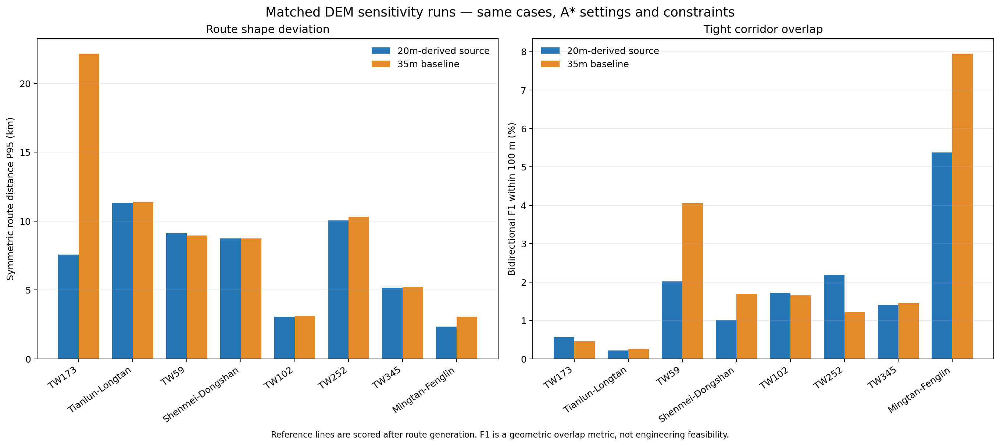
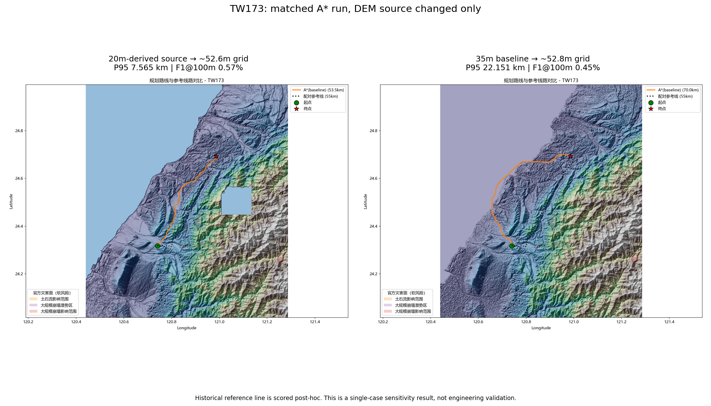

# DEM 来源配对敏感性实验（2026-10-25）

## 结论

用同一 A* 配置对 8 条搜索窗口可被两套 DEM 完整覆盖的线路做了配对运行。20 m 派生栅格在双向距离 P95 上有轻微、但不稳定的改善；`F1@100m` 几乎没有变化，线路长度误差的配对中位变化略有改善。**证据不足以把 20 m 栅格设为默认 DEM，也没有达到 100 m 贴合目标。**单条 TW173 的显著改善拉低了 20 m 组的 P95 汇总，不能据此推断对其他线路有效。



TW173 例图显示两套 DEM 在相同搜索参数下生成了明显不同的线路；20 m 派生来源在本例更贴近参考线，但单例差异不能证明该来源整体更准确。



## 配对设计

- 两组都运行相同的 A* 基线、默认代价权重、`window-margin-deg=0.3`、`max-side=2048`、8 条端点任务、OSM 建筑/土地利用缓存和官方灾害瓦片。人口代价、AI 诊断、转弯代价均关闭。
- 规划阶段只读端点 CSV；历史线路仅用于路线生成后的空间相似度评分。代码在路线生成后调用 `POST-EVAL` 读取参考折线；参考线不进入代价面、候选生成或路线选择。
- 根据 20 m 栅格空间边界，剔除 20 m 搜索框不完整的 4 个案例（TW58、TW766、TW769、TW311）；其余 8 例在两套 DEM 上均覆盖完整搜索框。各运行均为 8/8 完成、0 失败、0 无路可达。
- `max-side=2048` 下，两套输入的实际像元尺度相近但逐案不同：20 m 源被降采样到约 51–67 m，35 m 基线约 51–67 m。因此这是**近似同尺度下的 DEM 来源/表面敏感性试验**，不是原生 20 m 与 35 m 分辨率对照。
- 两组运行都记录 100% 的规划路线 DEM 采样有效率，且对当前配置的硬约束检查均为 0 次违规。这不代表未配置的禁限建区、塔位、档距、弧垂、导线净空或审批条件已通过。

## 指标

`P95` 为双向米制距离分布的对称 P95；`F1@100m` 为规划线与参考线双向覆盖的 F1，不是工程可行性指标。长度误差是规划路线与参考线长度的绝对差占参考线长度百分比。

| 案例 | P95：20 m 来源 (km) | P95：35 m (km) | F1@100m：20 m | F1@100m：35 m | 长度误差：20 m | 长度误差：35 m |
|---|---:|---:|---:|---:|---:|---:|
| TW173 | 7.565 | 22.151 | 0.57% | 0.45% | 2.73% | 27.26% |
| 天輪~龍潭線 | 11.334 | 11.388 | 0.21% | 0.26% | 13.53% | 13.54% |
| TW59 | 9.128 | 8.967 | 2.02% | 4.05% | 0.25% | 0.81% |
| 深美～冬山線 | 8.745 | 8.748 | 1.01% | 1.69% | 3.80% | 4.09% |
| TW102 | 3.069 | 3.108 | 1.72% | 1.65% | 1.00% | 1.41% |
| TW252 | 10.046 | 10.312 | 2.19% | 1.22% | 3.17% | 0.79% |
| TW345 | 5.156 | 5.215 | 1.40% | 1.45% | 6.72% | 0.05% |
| 明潭-鳳林線 | 2.352 | 3.064 | 5.38% | 7.95% | 5.19% | 5.81% |
| **组内中位数** | **8.155** | **8.857** | **1.562%** | **1.552%** | **3.486%** | **2.750%** |

配对差值（20 m 减 35 m）的中位数为：P95 **−56.9 m**、F1@100m **−0.045 个百分点**、长度误差 **−0.349 个百分点**。20 m 来源在 8 例中有 7 例的 P95 较低、3 例的 F1@100m 较高、6 例的长度误差较低。由于单例幅度差异很大，组内中位数差与配对差值中位数不相同；两者都保留，避免只报告对结论有利的一种汇总口径。

没有一例接近“95%线路长度落在 100 m 内”：两组最佳 `F1@100m` 分别只有 5.38% 和 7.95%。因此这轮不能宣称达到用户指定的严格贴合目标。

## 数据与工程边界

- 20 m 文件为 `dem_20m_wgs84_bilinear.tif`，SHA-256：`e6171c023fe6b4f14ef7ccf7265b06d382a9903bde1d5399263b8fe8c2d36fc5`。配套清单记载原始文件来自第三方 Docker 镜像层，文件哈希与第三方公开哈希一致；这不是政府官方签名或来源认证。原始 TIFF 垂直基准未记录，清单中的 TWVD2001 声明未由 TIFF 元数据证实。
- 35 m 基线 `taiwan_dem_35m_georef_fixed.tif`，SHA-256：`dc963ff6047f911275e9d2b3be678539f09ee8457939511c094721be6a2b4025`；数据来源与垂直基准也未核实。
- 两套栅格的覆盖、NoData 分布和表面数值不同。TW173 的 20 m 源请求窗口约 69.6% 像元为 NoData（主要含海域），35 m 窗口近乎全有效；实际生成的两条路线 DEM 采样覆盖均为 100%。因此差异可能来自来源、NoData 边界及重采样的共同作用，不能归因于“20 m 分辨率更高”。
- 两组最高采样地面坡度分别达到 226.38% 和 226.49%。这是当前 DEM 路线剖面的观测值，不是塔线坡度或净空判定；项目尚缺经核验的逐档塔位、导线弧垂与净空输入。本试验只评价走廊筛查路线，不能作为线路可建性结论。
- 20 m 单例在 `max-side=4096` 下曾因内存分配失败；该运行的 `run_summary.json` 标记 `complete=false`，不纳入成功结果。配对批次降至 `2048` 后完成。失败记录也随证据保留。

## 可复现信息

- 源代码提交：`d9a2ac37ad818aa6aca4ab64da6fb4aa7b7b5bb4`，运行时工作树干净；Python 3.13.6。
- DEM 输入哈希：20 m 派生栅格如上；35 m 基线如上。
- 共同 OSM 缓存：`taiwan_buildings.pkl` SHA-256 `d601bd68ce1fdcf6833b53553db8f4378ee2f02ccdda20db51e19030b063c3d3`；`taiwan_landuse.pkl` SHA-256 `823b984a95b1ced79b2c73a5b438f6c3851316879f0f109b63a2015c54d7a093`。
- 共同灾害清单：`manifest.json` SHA-256 `d6d9328ad03a1ac73a8fc8aaf3cff8a1d4afdc59df4134da8d6a77f654bf320b`；`tiles.sha256` SHA-256 `3d0fcf3137def46c5ad5b5d2452da27c120fb42cfba68967c4f3d57751466a37`。
- 8 例端点输入 CSV、每批运行溯源、逐例指标、结果摘要及原始 TW173 对照图位于 [`docs/evidence/dem_sensitivity_cap2048_20261025`](evidence/dem_sensitivity_cap2048_20261025/)。
- 生成配对统计图与 JSON 的脚本：[`tools/compare_dem_route_runs.py`](../tools/compare_dem_route_runs.py)。复跑统计图：

```powershell
python tools/compare_dem_route_runs.py `
  --run-a outputs/dem20m_sensitivity_fullwindow_cap2048_20261025 `
  --label-a "20m-derived source" `
  --run-b outputs/dem35m_sensitivity_fullwindow_cap2048_20261025 `
  --label-b "35m baseline" `
  --out docs/figures/dem_sensitivity_8cases_cap2048_20261025.png
```

两批规划命令的唯一区别是 `--dem` 与 `--out-dir`：第一批使用 `--dem <dem_20m_wgs84_bilinear.tif> --out-dir outputs/dem20m_sensitivity_fullwindow_cap2048_20261025`，第二批使用 `--dem data/taiwan_dem_35m_georef_fixed.tif --out-dir outputs/dem35m_sensitivity_fullwindow_cap2048_20261025`。两条命令均使用相同 `--osm-cache-dir`、证据目录中的 8 例 CSV、参考线目录（仅后验评分）、`--no-vin --no-ppp --max-side 2048`。

## 下一步

暂不替换默认 DEM，也不按这 8 条历史线回调规划代价。下一轮先核验 DEM 权威来源、垂直基准、NoData 和独立控制点误差；只有数据质量可比后，再做更大范围的固定参数敏感性评估。要让站间规划有工程意义，还需逐档杆塔/走廊、档距、弧垂、地面净空和法定禁限建约束等经核验的工程数据；A* 自身无法从地形唯一反推出电力公司历史线路选择。
