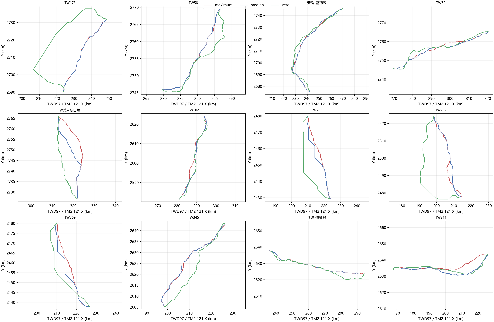
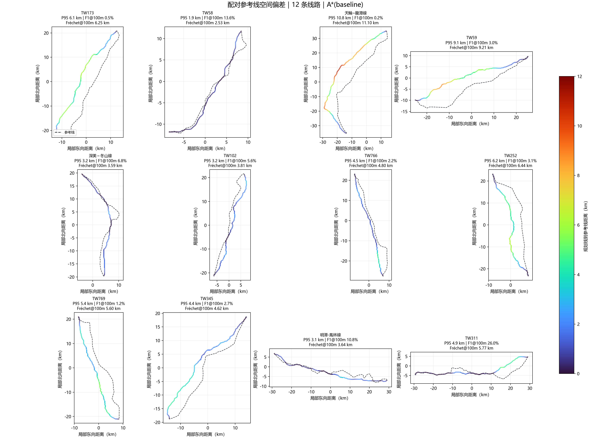
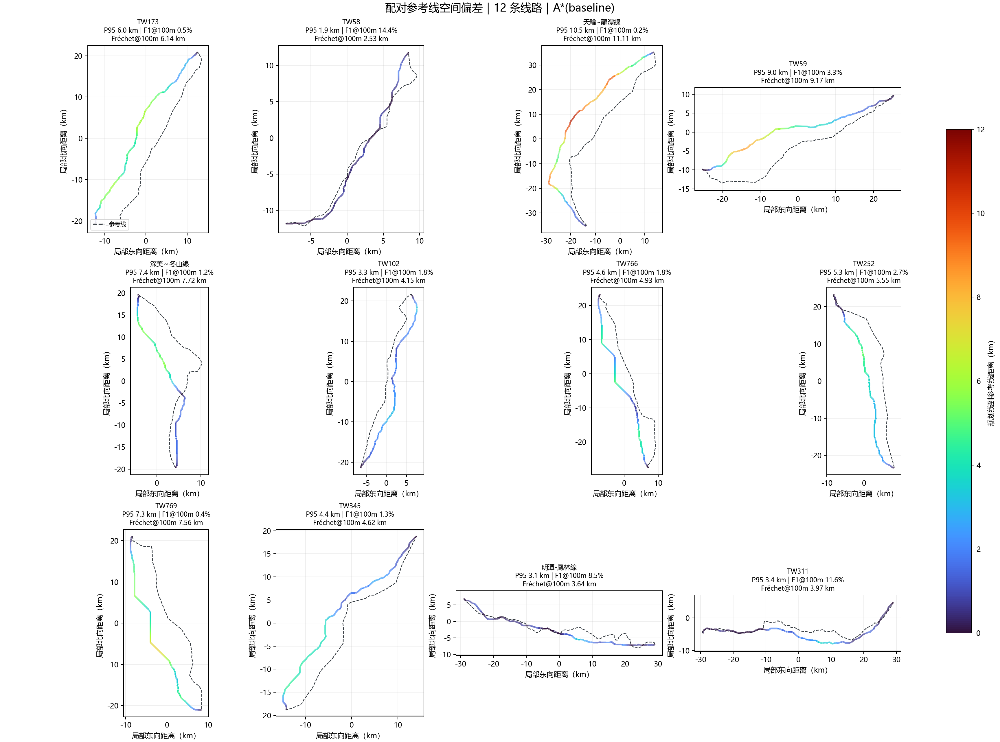
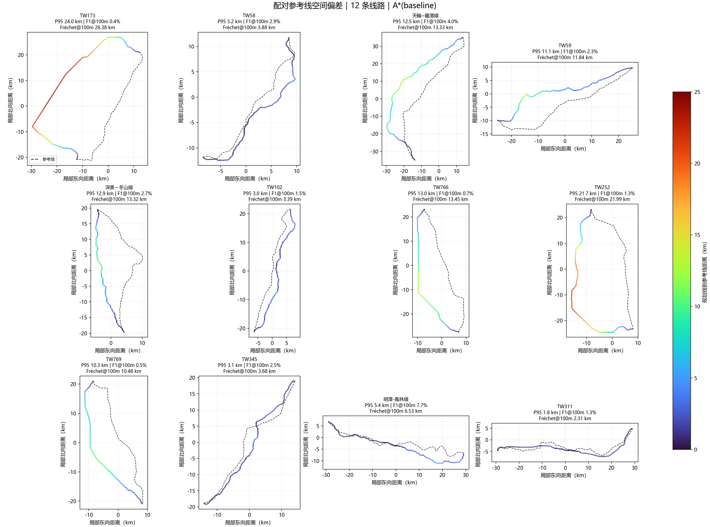

# WorldPop NoData 三策略 12 线路敏感性复测

## 目的与边界

固定同一 DEM、人口栅格、端点、OSM 缓存、官方灾害/软约束图层、A* 代码和参数，仅比较人口图层 NoData 的三种代价假设。`maximum` 将未知格赋最大归一化人口代价，`median` 赋当前规划窗 DEM 有效像元上的人口代理中位数，`zero` 将未知格代价设为零。三者都是情景假设，均不代表未知区的真实人口。

历史线路几何只在规划结果生成后作事后诊断，未进入规划搜索或策略选择。12 案与先前试验有样本重叠，端点源自历史线路首末点而非经核验的变电站线路侧接入点。因此本试验是敏感性评估，不是独立泛化测试，也不证明能够从地形重建真实输电线路。

## 运行与配对核验

- 三组均为 12/12 完成，失败 0、无路 0；规划方法为 CPU A*，VIN 和 PPO 均跳过。
- 三组均使用同一 WorldPop R2025A v1 栅格（9,795,141 bytes，SHA-256 `e963266859c6aa03c4e015e79bd62cceb1800a894a1d84e6bfe4748eb2cd7e75`）、权重 1.0、`max-side=4096`。
- WorldPop 来源元数据：[DOI 10.5258/SOTON/WP00839](https://doi.org/10.5258/SOTON/WP00839)，许可按数据源说明保留 [CC BY 4.0](https://creativecommons.org/licenses/by/4.0/) 归属信息。
- `scenario_comparison.json` 的门禁确认：三组规划输入哈希/大小/状态一致，运行时代码文件哈希一致，配置仅 `population_nodata_policy` 和 `out_dir` 不同，且逐案参考几何哈希相同。
- 总运行时间：maximum 约 1,310 秒（既有运行记录）；median 2,419 秒；zero 1,949 秒。运行时间不作为路线优劣指标。

## 汇总结果

下表中的 P95 和 F1 是历史线的**后验**相似度诊断，不用于选择策略。人口覆盖率、坡度、粗糙度、建筑/灾害和软约束暴露沿用栅格路线单元近似统计，除非字段明确说明，否则不是长度加权比例。

| NoData 情景 | 路线长度中位数 | 后验双向 P95 中位数 | 后验 F1@100m 中位数 | 人口有效覆盖率均值（范围） | 最大地面坡度中位数（最大） |
| --- | ---: | ---: | ---: | ---: | ---: |
| maximum | 55.68 km | 4.730 km | 3.02% | 82.2%（26.5–94.1%） | 80.5%（177.0%） |
| median | 54.45 km | 4.929 km | 1.81% | 68.8%（21.0–91.5%） | 68.8%（173.6%） |
| zero | 62.14 km | 10.716 km | 1.93% | 16.5%（5.4–40.3%） | 102.6%（168.1%） |

### 策略间路线几何稳定性

路线几何统一转换至 EPSG:3826，按约 100m 间距双向采样点到线距离；Hausdorff 是采样近似值。`F1` 表示采样线在指定走廊容差内的双向覆盖协调值。

| 配对 | 两策略间 P95 距离中位数 | F1@100m 中位数 | P95 距离大于 100m 的案例 |
| --- | ---: | ---: | ---: |
| maximum vs median | 2.242 km | 56.54% | 12/12 |
| maximum vs zero | 5.934 km | 3.57% | 12/12 |
| median vs zero | 4.495 km | 5.35% | 12/12 |

这说明规划结果对未知人口区的填补假设并不稳定；`zero` 尤其会把路线推向人口数据缺失区。首案 TW173 的 zero 路线比 maximum 长约 35.23 km，后验 P95 从约 6.05 km 上升到约 23.97 km。该单案只作示例，结论以全量配对表为准。

### 地形与风险代理指标

- DEM 采样有效率在所有路线均为 100%，但 DEM 数据源和垂直基准仍未独立核验。
- 最大地面坡度中位数：maximum 80.5%、median 68.8%、zero 102.6%；三组各自的最高值仍为 177.0%、173.6%、168.1%。`grade_limit_status` 未配置工程坡度阈值，不能把 `hard_violations=0` 解释为坡度或工程校核通过。
- 路线栅格的粗糙度 27 均值中位数分别约 34.3m、20.4m、19.5m；该值是 DEM 派生栅格代理，不能代表塔基地质或施工可达性。
- 当前已映射官方灾害层的路线单元暴露总体低；软约束面最大单案覆盖在 maximum、median、zero 分别约 1.02%、1.02%、16.35%。这些是现有图层上的单元近似值，未覆盖的风险类别不等于无风险。
- 三组都没有塔位、导线型号/荷载、允许档距、垂直基准一致的弧垂/净空和许可数据；本结果只属于固定端点走廊筛查，不能确认工程可建性。

## 解释

本轮没有选出“最优 NoData 策略”。最大惩罚不是未知区真实人口，中位数不是观测值，零填补更不能解释为无人居住。所有配对在 100m 尺度都出现路线差异，说明当前人口层存在的数据缺失本身足以改变走廊，应先补齐或核验覆盖数据，并把不同假设下的多条走廊作为不确定性结果展示。

真实线后验指标仍远未达到 100m 级目标：三组 F1@100m 中位数均低于 3.1%。只用地形和约束无法从公开栅格唯一确定历史线路实际走向；误差改善不能替代经核验的站端接入点、线路电压/回路和工程参数。

## 图件



maximum 后验误差图：

median 后验误差图：

zero 后验误差图：

逐策略、逐线路图件、规划路线和参考几何、指标、运行 provenance、SHA-256 清单均在 [`evidence/population_nodata_three_policy_12cases_20261025/`](evidence/population_nodata_three_policy_12cases_20261025/)。

## 复现命令

在 V5.0 软件目录运行。maximum 组复用先前完整结果目录；median 与 zero 只改 NoData 策略和输出目录。

```powershell
D:\python\python.exe -m transmission_path_planner `
  --dem data\taiwan_dem_35m_georef_fixed.tif `
  --osm-cache-dir D:\大创\V5_final\data\downloaded `
  --real-cases-csv D:\大创\data\real_cases_tw\real_cases.csv `
  --real-dir D:\大创\data\real_cases_tw `
  --constraint-geojson data\official_constraints_20261023.geojson `
  --population-raster data\external_sources\worldpop_twn_2020_100m_r2025a\twn_pop_2025_CN_100m_R2025A_v1.tif `
  --population-weight 1.0 `
  --population-nodata-policy median `
  --out-dir outputs\population_w1_median_12cases_20261025 `
  --no-vin --no-ppp --max-side 4096

# 将上述策略改成 zero，输出目录改成 outputs\population_w1_zero_12cases_20261025 即可复跑零填补组。

D:\python\python.exe tools\compare_population_nodata_scenarios.py `
  --maximum outputs\population_w1_12cases_20261025 `
  --median outputs\population_w1_median_12cases_20261025 `
  --zero outputs\population_w1_zero_12cases_20261025 `
  --output-dir docs\evidence\population_nodata_three_policy_12cases_20261025
```
