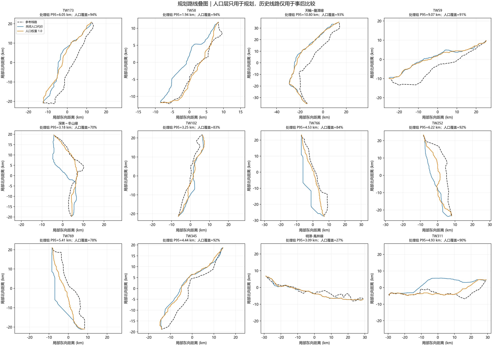
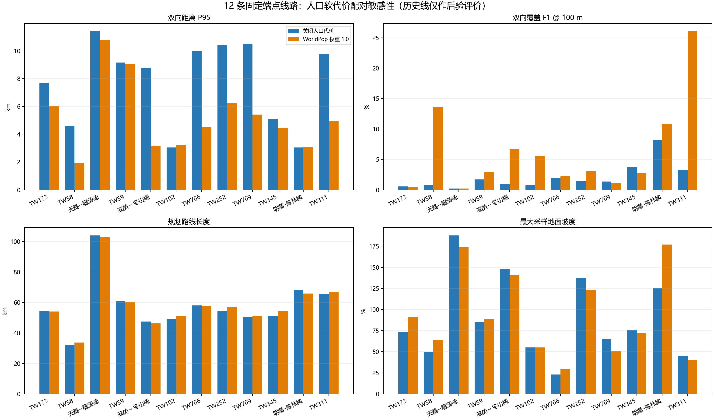

# WorldPop 人口代价 12 线路配对敏感性复测

## 结论

在固定 DEM、端点、官方灾害图层、软约束面和运行时代码的配对试验中，仅增加 2025 年 WorldPop 人口栅格软代价（权重 1.0，NoData 按最大归一化惩罚处理）。12/12 案成功，没有失败或无路案例；12 条规划几何都发生变化。

| 指标 | 不含人口代价 | 含人口代价 | 变化 |
| --- | ---: | ---: | ---: |
| 双向 P95 距离中位数 | 8.959 km | 4.730 km | 减少 4.228 km |
| 双向 F1@100 m 中位数 | 1.372% | 3.017% | 增加 1.645 个百分点 |
| P95 改善案例 | — | 10/12 | — |
| F1@100 m 改善案例 | — | 9/12 | — |
| 人口图层有效覆盖率均值 | 不适用 | 82.2% | 单案范围 26.5%–94.1% |

人口代价给出了值得继续检验的敏感性信号，但不能据此宣布规划器已达标：处理组的 F1@100 m 中位数仍只有约 3%，距离 100 米级贴合目标很远。双向距离改善也只是事后诊断，不是人口权重的选取依据。

## 逐线路结果

P95 和 F1 均采用双向空间覆盖指标；长度差为“含人口代价路线减不含人口代价路线”。地面坡度是沿路线 DEM 采样得到的最大局部地面坡度比，不是导线弧垂/净空或塔基可行性校核。

| 线路 | P95 (km) 基线 → 人口 | F1@100 m 基线 → 人口 | 长度变化 (km) | 人口有效覆盖 | 最大地面坡度 (%) 基线 → 人口 |
| --- | ---: | ---: | ---: | ---: | ---: |
| TW173 | 7.69 → 6.05 | 0.55% → 0.47% | -0.51 | 94.1% | 73.17 → 91.52 |
| TW58 | 4.57 → 1.94 | 0.78% → 13.62% | +1.33 | 93.7% | 49.15 → 63.85 |
| 天轮—龙潭线 | 11.40 → 10.80 | 0.22% → 0.23% | -1.31 | 92.7% | 187.79 → 173.64 |
| TW59 | 9.16 → 9.07 | 1.72% → 2.96% | -0.60 | 91.2% | 85.21 → 88.53 |
| 深美—冬山线 | 8.76 → 3.18 | 0.99% → 6.78% | -1.16 | 70.0% | 147.71 → 140.74 |
| TW102 | 3.05 → 3.25 | 0.74% → 5.61% | +1.90 | 82.8% | 55.06 → 55.06 |
| TW766 | 10.01 → 4.53 | 1.89% → 2.23% | -0.31 | 83.7% | 23.06 → 29.44 |
| TW252 | 10.43 → 6.22 | 1.39% → 3.07% | +2.65 | 92.4% | 136.97 → 123.05 |
| TW769 | 10.51 → 5.41 | 1.36% → 1.15% | +0.70 | 77.9% | 65.03 → 50.87 |
| TW345 | 5.09 → 4.44 | 3.70% → 2.71% | +3.23 | 91.5% | 75.94 → 72.49 |
| 明潭—凤林线 | 3.06 → 3.09 | 8.15% → 10.77% | -2.03 | 26.5% | 125.44 → 177.04 |
| TW311 | 9.77 → 4.93 | 3.25% → 26.04% | +1.30 | 90.3% | 44.80 → 39.79 |

注意：明潭—凤林线人口数据覆盖仅 26.5%，处理路线的最大采样地面坡度从 125.44% 上升到 177.04%。这说明对未知人口格网施加最大惩罚可能把路线推向地形更差的区域；人口图层必须和地形/工程指标并列检查，不能简单视为越大越安全。

## 图件





处理组完整双向误差图：[`12_route_error_overview.png`](evidence/population_w1_12cases_20261025/posthoc_error_maps/12_route_error_overview.png)。所有单案图、配对输出 GeoJSON、指标 CSV/JSON、两次运行清单及 SHA-256 清单位于 [`docs/evidence/population_w1_12cases_20261025/`](evidence/population_w1_12cases_20261025/)。

## 配对审计和边界

- 两组均完成 12/12，无失败、无无路案例。基线使用 `outputs/official_soft_constraints_ab_20261025/`，处理组使用 `outputs/population_w1_12cases_20261025/`。
- 两组共享规划输入共 153 项，全部哈希、大小和状态相同；处理组只增加 1 个 `population_raster` 输入。配置差异仅为人口栅格、人口权重、NoData 策略及输出目录。
- 基线与处理组运行时代码逐文件 SHA-256 相同。Git 提交号不同，且基线 provenance 标记 dirty；因此本报告以运行时代码哈希和规划输入哈希门禁为准，不把提交号相同当作配对条件。
- 两组每一条参考几何 SHA-256 相同。参考线仅在规划路线产生后载入评分，未进入路线搜索、路线选择或参数调整。
- 这不是独立盲测：本 12 案与先前人口敏感性研究有 3 条重叠。因此结果是范围扩大的探索性复测，不是独立泛化证明，也不应基于 P95/F1 再选人口权重。
- WorldPop 是估算人口网格，不是建筑点、普查户界、法定禁限建区或现场调查。平均有效覆盖率 82.2%，未知格按固定最大代理惩罚，不代表未知区人口真的最多。人口代价可能改变路径但不能证明规划许可或工程可建。
- 人口输入为 WorldPop 2025 R2025A v1；数据 DOI 为 [10.5258/SOTON/WP00839](https://doi.org/10.5258/SOTON/WP00839)，许可为 [CC BY 4.0](https://creativecommons.org/licenses/by/4.0/)，复用时应保留归属说明。栅格文件 SHA-256 见处理组 `run_provenance.json` 和 `data/external_sources/worldpop_twn_2020_100m_r2025a/SHA256SUMS.txt`。
- 处理组最大采样地面坡度仍最高达 177.04%，没有经过验证的塔位、跨距、弧垂、基础、净空、电压等级或许可数据；结果仍是固定端点走廊筛查。
- 端点仍来自历史线路的首末点，不是已经核验的变电站线路侧接入点。现有公开台电电杆资料没有输电回路归属，不能替代站端/塔位数据。

## 复现

在软件目录执行人口代价处理组：

```powershell
D:\python\python.exe -m transmission_path_planner `
  --dem data\taiwan_dem_35m_georef_fixed.tif `
  --osm-cache-dir D:\大创\V5_final\data\downloaded `
  --real-cases-csv D:\大创\data\real_cases_tw\real_cases.csv `
  --real-dir D:\大创\data\real_cases_tw `
  --constraint-geojson data\official_constraints_20261023.geojson `
  --population-raster data\external_sources\worldpop_twn_2020_100m_r2025a\twn_pop_2025_CN_100m_R2025A_v1.tif `
  --population-weight 1.0 `
  --population-nodata-policy maximum `
  --out-dir outputs\population_w1_12cases_20261025 `
  --no-vin --no-ppp --max-side 4096
```

配对检查和图件命令：

```powershell
D:\python\python.exe tools\compare_population_ab_runs.py `
  --baseline outputs\official_soft_constraints_ab_20261025 `
  --treatment outputs\population_w1_12cases_20261025 `
  --output-dir docs\evidence\population_w1_12cases_20261025

D:\python\python.exe tools\plot_route_error_maps.py `
  --results-dir outputs\population_w1_12cases_20261025 `
  --output-dir docs\evidence\population_w1_12cases_20261025\posthoc_error_maps
```
