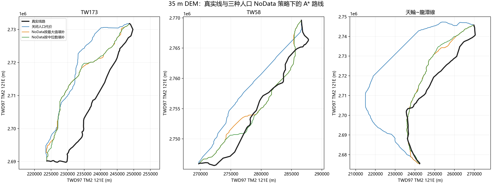
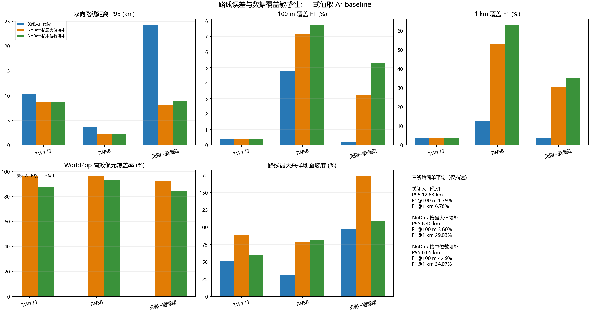

# WorldPop 缺失值策略三线路敏感性复测

日期：2026-10-25
规划代码：`120c88f4ddd7498d2597356619d2a58293a2cd93`（干净工作树）

## 结论

在相同的 35 m DEM、任务端点、灾害约束和代码版本下，人口栅格的 NoData 处理会显著改变路线。三线路 A* 的宏平均双向 P95 距离从关闭人口代价时的 **12.83 km** 降到最大值填补时的 **6.40 km**；中位数填补为 **6.65 km**。但 100 m 双向 F1 仍只有 **1.79%–4.49%**，远未达到“95% 线路长度位于 100 m 内”的目标。宏平均只是等权描述，不能掩盖 TW173 的 F1@100 m 仍只有约 0.4%。

本轮不能据此认定人口代价能使线路规划贴近真实线，也不能按真实线重合度选择 NoData 策略。该数据只有约 **84.58%–96.37%** 的规划路线栅格单元有有效人口值；缺失区域占比和填补假设仍会影响路径。现有案例端点也取自历史线路首末点，所以它们评估的是**给定历史端点后的路径形状**，不是独立站点输入下的盲测。

## 三策略 A* 指标

P95 是规划线与真实线双向距离的 95 分位；F1 是双向采样点在所列容差内的调和平均。人口覆盖率为规划路线经过的有效 WorldPop 栅格单元比例，按栅格单元计数、未按路线长度加权；关闭人口代价时不适用。

| 线路 | 人口策略 | P95 距离 | F1@100 m | F1@1 km | WorldPop 有效覆盖 | 最大采样地面坡度 |
|---|---|---:|---:|---:|---:|---:|
| TW173 | 关闭人口代价 | 10.39 km | 0.394% | 3.74% | 不适用 | 51.25% |
| TW173 | NoData 最大值填补 | 8.70 km | 0.413% | 3.80% | 96.37% | 88.48% |
| TW173 | NoData 中位数填补 | 8.71 km | 0.423% | 3.83% | 87.60% | 59.66% |
| TW58 | 关闭人口代价 | 3.74 km | 4.776% | 12.55% | 不适用 | 30.40% |
| TW58 | NoData 最大值填补 | 2.32 km | 7.162% | 53.01% | 96.20% | 78.48% |
| TW58 | NoData 中位数填补 | 2.27 km | 7.755% | 63.12% | 93.13% | 81.16% |
| 天輪~龍潭線 | 关闭人口代价 | 24.34 km | 0.190% | 4.05% | 不适用 | 97.82% |
| 天輪~龍潭線 | NoData 最大值填补 | 8.18 km | 3.224% | 30.29% | 92.61% | 173.64% |
| 天輪~龍潭線 | NoData 中位数填补 | 8.97 km | 5.289% | 35.26% | 84.58% | 109.26% |

| 等权三线路平均 | P95 | F1@100 m | F1@500 m | F1@1 km |
|---|---:|---:|---:|---:|
| 关闭人口代价 | 12.83 km | 1.787% | 3.880% | 6.778% |
| NoData 最大值填补 | 6.40 km | 3.600% | 16.159% | 29.034% |
| NoData 中位数填补 | 6.65 km | 4.489% | 22.314% | 34.071% |

地面坡度列为 DEM 采样路径的最大局部坡度比，不是导线弧垂或杆塔结构校核。超过 100% 的值表示部分采样线段非常陡；本轮没有配置坡度硬阈值，因此“硬约束违规数为 0”不能解读为工程可行。最大值填补下天輪~龍潭线达到 173.64%，两种人口策略的路径都需要单独进行地形、塔位和基础工程审查。

## 路线叠图

黑线为参考线路；其余仅绘制正式 A* baseline。采样 Pareto 候选没有参与最终路线选择。



## 指标图



## 配对与复现核验

- 三组 `run_summary.json` 均为 3/3 完成，无失败案例、无无路案例；三组由同一干净提交 `120c88f` 运行。
- 152 项公共输入在三组间哈希相同，包括相同的任务 CSV（SHA-256 `1819afb182a729200bb13ccb53fa61fcea2054b5452cc08a725a5487ce9d14f2`）、35 m DEM（`dc963ff6047f911275e9d2b3be678539f09ee8457939511c094721be6a2b4025`）、官方灾害清单和 146 个灾害瓦片。OSM 建筑与土地利用图层未取得，权重为 0；PPP/VIN 关闭。
- 最大值与中位数两组使用同一 WorldPop 栅格（SHA-256 `e963266859c6aa03c4e015e79bd62cceb1800a894a1d84e6bfe4748eb2cd7e75`）。三组的输出参考线路 GeoJSON 哈希逐案完全相同；规划输入配置仅在人口栅格、人口权重和 NoData 策略上不同，另有输出目录差异。
- 每条路线的 Pareto 冻结清单均记录 `reference_geometry_used_for_planning=false` 和 `frozen_before_reference_read=true`，候选通过代码中的后验硬约束复核。它们只用于**搜索后诊断**，不得据此挑选更贴近参考线的正式路线。
- 由于运行溯源格式没有自动哈希参考几何，本报告脚本另外记录各参考 Shapefile sidecar 和各次导出的 `real_route.geojson` SHA-256。完整明细见 [`paired_metrics_and_provenance.json`](figures/population_nodata_sensitivity_20261025/paired_metrics_and_provenance.json)。

重建指标、路线叠图与指标图：

```powershell
D:\python\python.exe scripts\analyze_population_nodata_sensitivity.py --real-dir D:\大创\data\real_cases_tw
```

## 解释边界与下一步

1. 本实验是单个人口权重（1.0）的缺失值敏感性分析，不是权重校准或策略优选。中位数填补的 F1 较高，但路线上的人口数据覆盖更低；最大值填补的宏平均 P95 较低，也不代表它在真实工程上更正确。
2. 历史线路形状只用于搜索完成后的评价；但输入端点本身来自历史线路终点。应先取得独立可追溯的变电站线路接入点及线路归属，再冻结新的站间任务开展盲测。当前台电公开站点容量表不含可直接使用的站端接入坐标，现有少量电杆记录也不足以构成高压输电塔网。
3. 当前 OSM 建筑/土地利用数据缺失，统计区人口 XML 资源在本环境的下载接口返回 HTTP 403，未加入代价层。官方目录列有[最小统计区图](https://data.gov.tw/dataset/25128)和[统计区人口统计](https://data.gov.tw/dataset/18681)，需取得并核验对应县市数据后再评估是否用作 WorldPop 覆盖审计或校准。
4. 下一轮优先解决独立站端和人口/建筑暴露数据的可追溯性，并对极陡地面路径作工程筛查；在缺少经工程方确认的塔位、跨距、基础和净空限值前，不把任意坡度阈值包装成设计标准。
