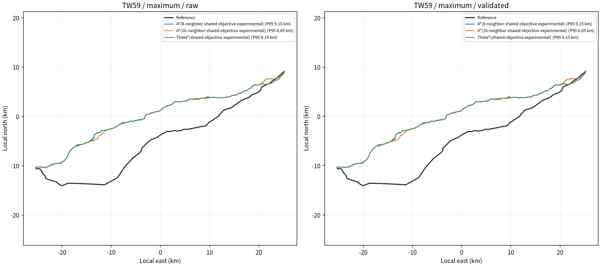

# 2026 DTM native-grid route comparison (2026-10-28)

## Result

The remote server completed six CPU-only route runs for three exploratory endpoint pairs (`TW59`, `TW345`, `TW102`) and two population-NoData policies (`maximum`, `median`). Each run emitted A*8, A*16, and Theta* search and validated geometries. Historical reference geometries were not read during planning. The posthoc scorer recorded all 36 raw/validated artifacts, verified their frozen hashes, and only then read the three reference geometries.

Across the 18 validated routes:

| Measure | Result |
| --- | ---: |
| Median symmetric P95 | 4,497.5 m |
| Symmetric P95 range | 3,027.0–9,156.4 m |
| Median F1 within 100 m | 2.59% |
| F1 within 100 m range | 1.28–7.23% |
| Median F1 within 500 m | 7.68% |
| Median F1 within 1,000 m | 13.75% |

Best individual results per case are descriptive posthoc scores, not a route-selection rule:

| Case | Best F1@100m | Best symmetric P95 |
| --- | ---: | ---: |
| TW59 | 2.11% (maximum / Theta*) | 8,849.2 m (maximum / A*16) |
| TW345 | 2.77% (median / Theta*) | 4,381.4 m (median / A*8) |
| TW102 | 7.23% (maximum / Theta*) | 3,027.0 m (maximum / A*8) |

The 20 m run was paired against the 35 m, 4096-cap experiment using the same frozen planner source, constraints, land mask, population raster, endpoints, and reference-geometry hashes; only the DEM and grid cap changed. On the 18 matched validated candidates, 13 improved F1@100m and 9 improved symmetric P95. Median F1@100m rose from 2.00% to 2.59%, while median symmetric P95 changed only from 4,499.5 m to 4,497.5 m (median paired delta +1.18 m). Finer terrain sampling alone therefore did not remove the kilometre-scale corridor offset.

The preview is a reduced JPEG copy of the server PNG. The full-resolution original remains at `/data1/B24041626/pp/dtm_2026_native_20m_3case_6400_20261028/results/posthoc_similarity_20261028/TW59_maximum_two_stage_overlay.png`.

## Engineering and data limits

- Every route is an exploratory endpoint-proxy case. These are not utility-confirmed station-side connection points or verified circuits.
- All three runs set `max_ground_grade=null`; `grade_limit_status=not_configured`. The maximum sampled ground-grade diagnostic reached 122.16% for TW102, 162.09% for TW345, and 259.06% for TW59. These values do not certify tower siting; they show why the result must not be called engineering-feasible.
- `hard_violations=0` means only that the masks enabled in the frozen run were not violated. The project constraint GeoJSON contained 140 soft features and no declared hard features. Building clearance was 0 m. No conductor, sag, tower, span, right-of-way, crossing permit, or voltage-specific engineering check was evaluated.
- WorldPop is a modelled exposure surface; its NoData fill was a sensitivity variable, not an observed population count. The route reference geometry remained posthoc only.
- The 2026 Taiwan 20 m DTM raster was obtained from a public Docker Hub image containing a source/integrity record. The original file hash matches that record, but the official TGOS ZIP was not retained or byte-compared with the mirror. Source documentation identifies EPSG:3826 and TWVD2001; its TIFF GeoKey is user-defined, so the planner input explicitly assigned EPSG:3826 through a VRT and was bilinearly reprojected to EPSG:4326. Twenty-metre grid spacing is not a statement of vertical accuracy.

The next useful gains require better constraint and engineering inputs, especially verified station connections, circuit identity, tower/conductor parameters, and complete crossing/environment layers. Reweighting terrain costs against reference lines would violate the no-route-prior planning rule and was not done.

## Reproduction and integrity

All route planning, scoring, error calculation, and map generation ran on `/data1/B24041626/pp`; no route calculation ran on the user's PC.

- Experiment: `/data1/B24041626/pp/dtm_2026_native_20m_3case_6400_20261028/`
- Results: `/data1/B24041626/pp/dtm_2026_native_20m_3case_6400_20261028/results/`
- Planner command was frozen in `run_summary.json`: 2026 DTM, `--max-side 6400`, `--window-margin-deg 0.3`, A*8/A*16/Theta*, `--grade-penalty-weight 0`, zero turn penalties, no AI diagnostics, and empty `CUDA_VISIBLE_DEVICES`.
- Cases and cost weights are recorded in the remote `results/run_summary.json` `argv` records. Resource guards and per-run logs are also preserved there.
- Plan SHA-256: `8d5f8f31f12b29a9185516eb76a18da829076ac455799489840f23568e9778a2`
- Candidate-freeze SHA-256: `e26c84b831f389339c4b214703a357b4d59d1032e1ec1e9747c7c030aa623b89`
- Frozen run-summary SHA-256: `0fe7c06159057edf78a76078642438aa0b534c10f4e2c35a463d56eacd84da22`
- Posthoc JSON SHA-256: `85e50f3ea6f8d17d4e14a4c22103011c3fab30a2078bb9e652da83cf99ceeb66`
- Posthoc CSV SHA-256: `619b2196abb78d5d1e6c6fcbbe2bd00ad58638b24b1f728f0c933509a8f963a4`
- Paired-delta CSV SHA-256: `b4b93b4603272cf8d40d309d37e4672cfae49d7180f011c163cb4c72ebbc8f44`
- Derived 20 m planner DEM SHA-256: `661bee946235602398c67a46cc76d1180952ccc52d104b73b481b57d9a557fbe`
- Source TIFF SHA-256 from `SOURCE.txt`: `f05912e2233b40497c1b9d7f469893f668823f72005a949e9634ce69303d0e3f`
- Source README, Docker image digest, layer digest, and original raster metadata are recorded in `/data1/B24041626/pp/dtm_2026_original_raster_from_public_image_20261028_01/SOURCE.txt`.
- Three reference GeoJSON hashes were identical in the paired runs: TW59 `d846309e7edfd366aaff17e32df16c772bcf63066385bfc127e08f730cf5ec51`; TW345 `6cb7b2fef118533582b95a02e42a014b494d3d323b7737acb259f68e9d1885ce`; TW102 `a72a005a9f3287587d277a6216a961bfc87887254742d0154bb7901ff7963d18`.

## Official data and constraint sources

- [2026 Taiwan 20 m DTM dataset](https://data.gov.tw/dataset/178729). The catalogue describes a 20 m DTM for terrain display and approximate analysis; grid spacing does not imply elevation accuracy. The experiment used a hash-pinned mirror copy and documents the reprojection above.
- [MOEA geological-sensitive-area dataset](https://data.gov.tw/dataset/27744). Official open data, but its own note says the numerical delineation layer is for reference and final extents must be checked against the announced official maps. It should be treated as a soft screening layer until legal applicability and exact boundaries are verified.
- [MOA nature-reserve dataset](https://data.gov.tw/dataset/24914). Open data with reserve polygons and management metadata; current version and boundary accuracy must be confirmed before using as a hard exclusion.
- [Taipei public transmission-system utility-pipeline layer](https://data.taipei/dataset/detail?id=d506226a-a236-4b05-850f-d656ef53162d). This is municipal utility-pipeline geometry with endpoint IDs and installation attributes, not nationwide overhead transmission topology; the publisher warns that exact data should be confirmed with the utility.
- [Central-managed river area lines](https://data.gov.tw/dataset/129299). The catalogue marks this free under OGL v1 and its resource metadata lists a 2025-07-09 source date; WRA's layer registry reports a 2026-03-31 update. The official download endpoint timed out from the planning server on 2026-10-28, so no file was saved or used. It covers central-managed rivers only, not all local rivers, and should support crossing/permit screening rather than act as an automatic no-crossing mask.

These candidate layers were researched after the frozen run and were **not** included in its inputs.

## Reference-free method-agreement check (2026-10-28)

After the real-line posthoc evaluation was complete, the three search methods were compared pairwise across the six case/policy runs without reading any historical route geometry. All 36 frozen GeoJSON artifact hashes and canonical geometry hashes were checked before geometry parsing. Raw and validated outputs were kept separate. The existing project metric implementation (version 6, 20 m arc-length sampling and bidirectional distance/coverage) was reused with one case-wide projection center derived only from the candidates.

Raw-route agreement, before validation and smoothing:

| Method pair | Median F1@100 m | F1@100 m range | Median F1@500 m | Median symmetric P95 | Maximum symmetric P95 | Strong agreement |
| --- | ---: | ---: | ---: | ---: | ---: | ---: |
| A*8 vs A*16 | 90.4% | 82.5–97.7% | 99.1% | 289 m | 655 m | 1/6 |
| A*8 vs Theta* | 86.8% | 75.7–92.3% | 99.1% | 318 m | 646 m | 0/6 |
| A*16 vs Theta* | 92.6% | 82.5–97.6% | 100.0% | 174 m | 637 m | 2/6 |

Across the six case/NoData-arm groups per method pair, validated-route agreement was:

| Method pair | Median F1@100 m | F1@100 m range | Median F1@500 m | Median symmetric P95 | Maximum symmetric P95 |
| --- | ---: | ---: | ---: | ---: | ---: |
| A*8 vs A*16 | 90.4% | 82.5–97.7% | 99.1% | 289 m | 654 m |
| A*8 vs Theta* | 86.7% | 75.7–92.2% | 99.1% | 318 m | 646 m |
| A*16 vs Theta* | 92.6% | 82.4–97.6% | 100.0% | 174 m | 632 m |

The 100 m diagnostic requiring F1 and both directional coverages of at least 95%, plus symmetric P95 no greater than 100 m, passed in only 1/6, 0/6, and 2/6 groups respectively. At 500 m, methods nearly agree on a broad corridor. Yet their median pairwise P95 is only 174–318 m, while the validated routes' median P95 against historical references is about 4.5 km. This makes search-neighbor choice alone an unlikely explanation for the main mismatch. The next useful iteration should focus on verified corridor constraints, the cost-surface model, and utility-confirmed station connection points, while continuing to exclude historical line geometry from planning.

Per-case validated medians across the two NoData arms:

| Case | Pair | Median F1@100 m | Median symmetric P95 |
| --- | --- | ---: | ---: |
| TW59 | A*8 vs A*16 | 91.5% | 287 m |
| TW59 | A*8 vs Theta* | 86.7% | 348 m |
| TW59 | A*16 vs Theta* | 86.9% | 415 m |
| TW345 | A*8 vs A*16 | 82.7% | 489 m |
| TW345 | A*8 vs Theta* | 77.8% | 490 m |
| TW345 | A*16 vs Theta* | 93.4% | 103 m |
| TW102 | A*8 vs A*16 | 94.4% | 168 m |
| TW102 | A*8 vs Theta* | 89.9% | 233 m |
| TW102 | A*16 vs Theta* | 95.7% | 147 m |

Raw-to-validated medians changed by less than 1 m in symmetric P95 and 0.04 percentage points in F1@100 m for every pair. The validation stage therefore did not make these search methods converge to the same detailed route.

The per-pair CSV, full summary, and runnable scorer are retained on the server at `/data1/B24041626/pp/method_agreement_20m_20261028_01/`. The scorer records its input hashes and package versions; no reference files are in its input list. Integrity values from the server summary:

- Scorer SHA-256: `fba022db19822c7e30031d8f6cf1325d3ce094bc51ca31e20c42d75e8077edb1`
- Per-pair CSV SHA-256: `27f84d61f711d6084fcfc9227aec6897a8274404422bd2909563babe85027e8b`
- Full summary SHA-256: `dc395d121842d2c07ba3118917606bbcaf45d22f2c2912039aaa14d589b8f827`
- Candidate-freeze SHA-256: `e26c84b831f389339c4b214703a357b4d59d1032e1ec1e9747c7c030aa623b89`
- Run-summary SHA-256: `0fe7c06159057edf78a76078642438aa0b534c10f4e2c35a463d56eacd84da22`
- Metric source SHA-256: `b6f3808ea9a36843d1195404899aa0be72f9c6f3b2903125c4a0fdb21a305574`
- Scoring environment: Python 3.11.5, NumPy 2.4.6, Shapely 2.2.0, pyproj 3.7.2.

## Server-side DTM integrity recheck

On 2026-10-28, the authenticated server session recomputed SHA-256 for the raw TIFF (`f05912e2233b40497c1b9d7f469893f668823f72005a949e9634ce69303d0e3f`) and TFW (`7e497cc09921a3fa2091d1a3680d99721883145ef77f700b88bc4211270ffa32`); both matched the values in the server's `SOURCE.txt` and the third-party fetcher's published pins. The derived planner TIFF's SHA-256 (`661bee946235602398c67a46cc76d1180952ccc52d104b73b481b57d9a557fbe`) also matched the server's `PLANNER_INPUT.txt`. The raw TIFF, VRT, derived TIFF, and both text records were present on the server. Their binary files and source-record files are not in this local worktree, so this is a live server-side check rather than a locally reproducible checksum check. The original TGOS ZIP was not retained or compared.

The CRS remains an explicit processing assumption: the TIFF GeoKey is recorded as user-defined code 32767, and opening the original TIFF with Rasterio returned `crs.to_epsg() == null` with an embedded WGS 84 Transverse Mercator WKT (central meridian 121°, false easting 250,000 m). The third-party source project describes it as EPSG:3826/TWD97 TM2 zone 121 and TWVD2001; the planner's VRT explicitly assigned EPSG:3826 before bilinear reprojection. The GeoKey and Rasterio EPSG result do not establish EPSG:3826, and the vertical datum was not independently confirmed from a TIFF vertical-datum tag. An older 2025-10-25 manifest reports the same raw TIFF SHA but no source EPSG/authority, reads the embedded WKT without overriding CRS, and produces a different derived hash (`e6171c…d36fc`, 10172×18872); this run's assigned-CRS chain reports `661bee…557fbe`, 10170×18827. Treat those as distinct raster interpretations and do not pool their route scores until the CRS/vertical datum chain is independently adjudicated.
