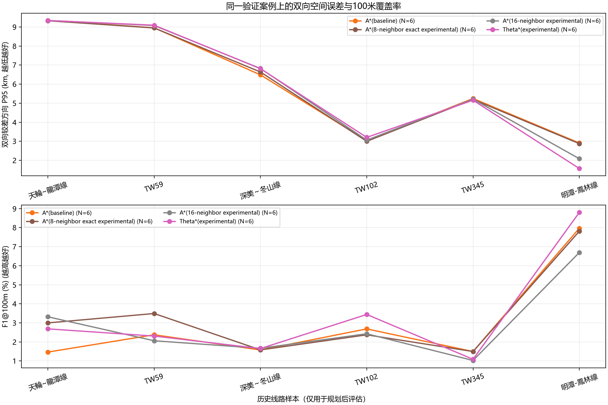

# A* / Theta* algorithm comparison

## Result

The run requested eight route tasks. Seven reached post-planning evaluation; TW252 failed before search because its supplied start endpoint maps to an OSM building obstacle. The batch is therefore recorded as incomplete. Of the seven evaluated routes, Theta* passed the final hard-constraint checks on six; its TW173 candidate was rejected after the building-geometry check. Every scored candidate had zero remaining hard-constraint violations.

The primary comparison is the six cases where all four methods produced a route accepted by validation. In that paired sample, no experimental heuristic produced a consistent accuracy gain:

| Method | Cases | Median generation time (s) | Symmetric P95 (km, lower is better) | Hausdorff (km, lower is better) | F1@100m (higher is better) | F1@1km | Absolute length difference |
| --- | ---: | ---: | ---: | ---: | ---: | ---: | ---: |
| Production A* | 6 | 9.32 | 5.865 | 6.240 | 1.975% | 14.058% | 5.020% |
| Exact-integral 8-neighbor A* | 6 | 11.29 | 5.916 | 6.356 | 2.685% | 15.031% | 4.758% |
| Exact-integral 16-neighbor A* | 6 | 21.49 | 6.016 | 6.328 | 2.243% | 13.252% | 4.877% |
| Theta* | 6 | 55.58 | 5.982 | 6.351 | 2.496% | 13.075% | 5.196% |

Medians above use the **same six cases for every method**; TW173 is excluded because Theta* failed building validation. The exact-integral 8-neighbor A* control and Theta* share the same raster edge-cost model, turn/soft-grade settings, endpoint handling, and post-processing. Evaluation uses route-similarity version 6 and a common projected CRS per case. The per-case CRS check passed for all seven scored cases.

Theta* beat the exact-integral A* control on symmetric P95 in two of six cases and lost in four. It improved F1@100m in three cases and reduced it in three. Its common-sample median P95 was 66 m worse, median F1@1km was 1.96 percentage points lower, and median route-generation time was 55.58 s versus 11.29 s for exact-integral 8-neighbor A*. This evidence does not justify replacing production A* with Theta* or making Theta* selectable as the final route.



The maps below compare the accepted candidate routes against reference lines for the evaluated cases. TW173 has no Theta* line because that candidate was rejected by the building check; the map clearly shows the three valid routes. These are diagnostic plots, not engineering approval maps.

- [TW173 route comparison](maps/01_TW173.png)
- [天輪~龍潭線 route comparison](maps/02_天輪~龍潭線.png)
- [TW59 route comparison](maps/03_TW59.png)
- [深美～冬山線 route comparison](maps/04_深美～冬山線.png)
- [TW102 route comparison](maps/05_TW102.png)
- [TW345 route comparison](maps/06_TW345.png)
- [明潭-鳳林線 route comparison](maps/07_明潭-鳳林線.png)

## Scope and limits

- Historical line geometry was loaded only for post-planning evaluation; it did not enter the search or candidate selection. Task endpoints came from historical-line samples and are not independently verified substation or line-side connection points. This is not yet a verified station-to-station engineering evaluation.
- The run used the local 35 m-source DEM with `--max-side 1024`; actual planning pixels were about 102–134 m. The DEM vertical datum is not independently verified.
- Available OSM buildings and land use were used within their observed coverage. The run did not include verified tower locations, conductor clearance, span design, siting permits, or authoritative station entrance points. Zero configured hard-mask violations do not establish engineering feasibility.
- The run summary correctly reports `complete: false` because TW252 failed at endpoint validation. Do not describe the batch as eight successful routes.
- The source tree was dirty during execution. `run_provenance.json` records the source-file hashes, data hashes, runtime, task inputs, and exact command. `route_algorithm_summary.json` separately hashes the post-planning reference files so those evaluation inputs remain distinguishable from planning inputs.

## Artifacts

- `comparison_metrics.json`: per-case route, validation, and post-hoc similarity metrics.
- `run_summary.json`: requested/completed/failed task counts and per-case outcomes.
- `run_provenance.json`: exact command, configuration, code and planning-input hashes, runtime versions, and outputs.
- `route_algorithm_metrics.csv`: flattened per-case method records, including rejected and failed outcomes.
- `route_algorithm_summary.json`: paired medians, case counts, projection checks, and evaluation-only reference-file hashes.
- `routes/`: accepted method paths and selected final routes in JSON/GeoJSON.
- `maps/`: per-case route comparison figures.

## Reproduction

From the software root, rerun the planning batch with the command recorded in `run_provenance.json`, then regenerate the analysis with:

```powershell
py -3.13 -X utf8 scripts\summarize_route_algorithm_ab.py `
  outputs\heuristic_control_ab_8cases_exact_1024_20261025 `
  docs\evidence\heuristic_control_ab_8cases_exact_1024_20261025
```
