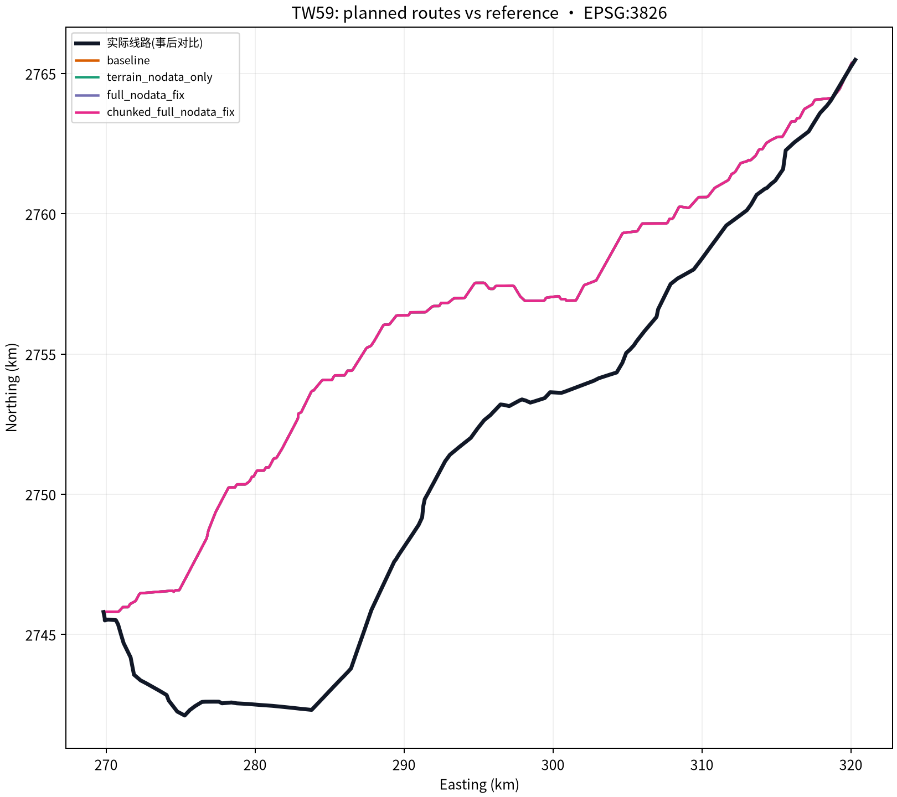
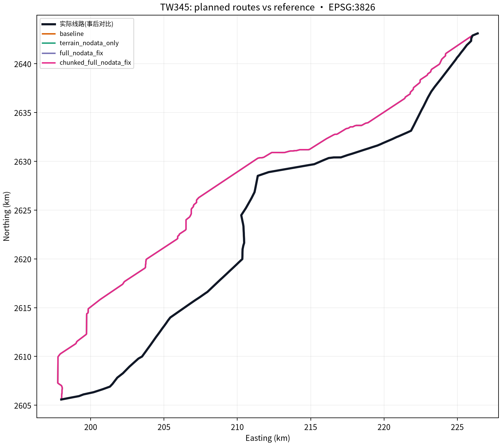
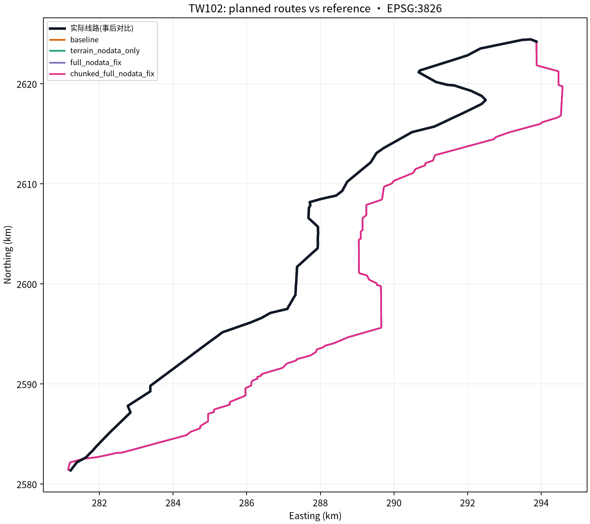

# 台湾线路 NoData 与分块计算对照

## 执行结果

规划、误差评分和图像生成均在 `benke@10.166.33.23` 的 `/data1/B24041626/pp/terrain_nodata_memory_ablation_4arm_3case_20261029` 完成。候选线路先全部规划并冻结文件与几何哈希，再读取实际线路作事后评分；历史线路几何没有进入路线搜索。

实验包含 3 组台湾样本 × 4 个算法臂，共 12 条路线。A* 使用 CPU，GPU 未参与；每次只运行一条任务，使用约 35 米 DEM、2048 最大网格边长、官方约束、灾害瓦片及 OSM 建筑/用地缓存。数据哈希见 `freeze.json` 和服务器 `run_summary.json`。

端点来自既有基准样本，是探索性代理坐标，**不是权威核验的变电站线路接入点**。这项限制会影响误差解释。

## 线路形状对比

“双向 100 米覆盖”分别统计规划线与实际线两侧落在 100 米内的长度比例；F1 为二者调和平均。100 米覆盖低于 95% 即没有达到“95%线路长度落在 100 米内”的严格标准。

| 样本 | 双向对称 P95 偏离 | 规划→实际 100 米覆盖 | 实际→规划 100 米覆盖 | F1@100 米 | 长度误差 |
|---|---:|---:|---:|---:|---:|
| TW59 | 8,955.6 m | 4.0% | 3.8% | 3.9% | 4.3% |
| TW345 | 5,202.6 m | 1.4% | 1.4% | 1.4% | 0.1% |
| TW102 | 3,065.2 m | 1.7% | 1.6% | 1.7% | 0.8% |

长度误差虽为 0.1%–4.3%，但线路形状的 100 米双向覆盖只有 1.4%–4.0%，P95 偏离为 3.1–9.0 公里。长度接近不能代表走廊接近；这三组均远未达到 100 米贴合目标。

## 算法臂与资源表现

| 样本 | 单条耗时范围 | 进程峰值 RSS 范围 |
|---|---:|---:|
| TW59 | 57.7–60.8 s | 3.00–3.18 GiB |
| TW345 | 45.3–46.4 s | 2.88–3.07 GiB |
| TW102 | 35.0–36.1 s | 2.63–2.76 GiB |

每个样本的四个算法臂只有一个独特路线几何哈希：基线、地形 NoData 修正、完整 NoData 修正和分块修正产生了相同路线。因此，本次对照没有证明 NoData 修正能提高真实线路贴合度。2048 网格下，分块臂也没有带来明显的耗时或 RSS 降低；分块实现的主要用途是降低更大栅格的临时数组峰值，需要再用 4096/6400 网格实测。

## 边界与下一步

- 路线搜索仅使用地形与配置的约束；未加载人口栅格，土地利用权重为 0。
- 现有公开约束与灾害图层不能覆盖全部选线因素；OSM 覆盖率未核验。
- 最大地面坡度、塔型、导线、档距、弧垂、净空、电压规则和征地走廊均未校核。规划完成不等于工程可行。
- 下一轮应检查地形权重和约束代价是否改变走廊，并做高分辨率/全尺寸资源对照；继续以冻结候选后再评分的方式验证，避免用实际线路几何参与规划。

## 可复核文件

- `freeze.json`：端点、权重、数据哈希、资源保护阈值和工程限制。
- `prepare_source_bundle.py`、`execution_bundle.tar.gz`：生成服务器执行包（SHA-256：`d0a7dd4a06a62ea4437c388f4fd76f9f27e22d6d0c223459107c9395102d6769`）；算法代码以提交 `0653154b9ac54eeb2b7c3590fb2285927408213f` 为共享基线。
- `run_server_experiment.py`：服务器顺序规划和候选哈希冻结脚本。
- `score_posthoc_final.py`：候选冻结后校验路线哈希、计算双向误差并生成叠加图的评分脚本。
- `server_results/run_summary.json`、`candidate_freeze.json`、`route_similarity_posthoc.csv`、`route_similarity_posthoc.json`：运行记录、候选冻结与服务器事后评分结果。
- 服务器仍保留完整路线、日志和执行产物：`/data1/B24041626/pp/terrain_nodata_memory_ablation_4arm_3case_20261029/`。
