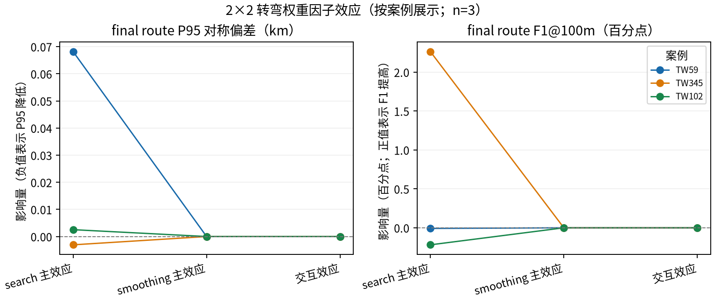
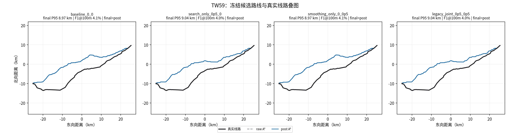
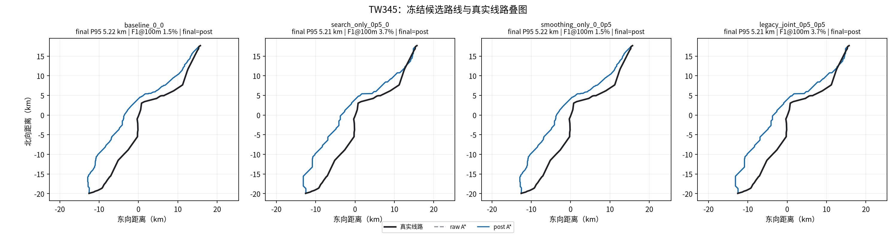
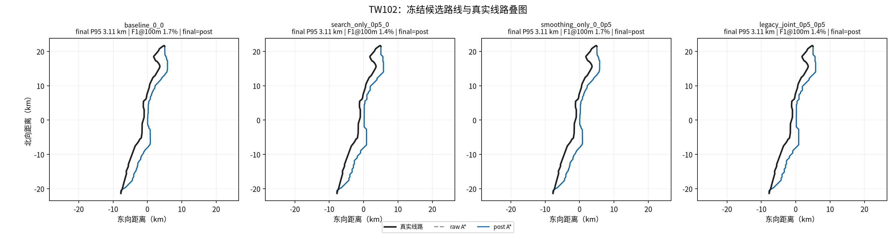

# 默认地形代价下的转弯因子三线路实验

## 预注册方案

固定三条地形分层端点（TW59、TW345、TW102）、35 m DEM 源、2048 最大边长、硬约束/陆域/官方灾害/OSM 图层及其他默认代价参数。恢复项目当前软代价默认值 `terrain_slope_weight=0.75`、`grade_penalty_weight=1.0`，转弯搜索项与约束感知平滑项分别取 0 或 0.5，形成 2×2×3 共 12 次规划。

四个处理臂：搜索/平滑 `(0,0)`、`(0.5,0)`、`(0,0.5)`、`(0.5,0.5)`。参考线路只用于候选全部生成并冻结后评分；规划运行器不提供参考线路路径或几何。

## 服务器预检

2026-10-27 12:23 UTC，只读预检确认：7 项冻结输入 SHA-256 全部匹配；目标目录不存在；项目 venv 存在；`/data1` 可用空间 269,399,445,504 字节；可用内存 108,592,287,744 字节；系统负载约 10.40/11.47/11.69；swap 已满。任务以 CPU、nice 10、单线程顺序运行，进程树 RSS 达 8 GiB 或可用内存低于 32 GiB 时停止并保留已有输出，不使用管理员命令、不覆盖或删除已有文件。

## 复现与验收

```bash
cd /data1/B24041626/pp/terrain_turn_factorial_3case_20261027/repo
nice -n 10 /data1/B24041626/pp/venv/bin/python docs/evidence/terrain_turn_factorial_3case_20261027/run_local.py
```

运行器先核验输入、源码、依赖清单、来源提交标记和自身哈希，再创建唯一输出目录。只有 12 个候选全部成功且路线文件/几何哈希冻结，实验才算完成；之后再运行隔离的 v6 后评分器。

## 实际结果

2026-10-27，服务器完成全部 12 次 CPU 规划，用时 29.78 分钟；单进程树峰值 RSS 3.044 GiB，最低系统可用内存约 98 GiB。12 次退出码均为 0。规划期间未读取真实线路；候选冻结后，本地逐项复核了 36 个 raw/post/final 文件 SHA-256，零不匹配，再按 v6 指标评分。完整运行摘要、候选冻结清单、评分表和图位于 [results](results/)。

| 案例 | 基线 P95 / F1@100m / 长度差 | 搜索转弯权重 0.5 | 结论 |
|---|---:|---:|---|
| TW59 | 8.967 km / 4.051% / -0.477 km | 9.035 km / 4.043% / -1.669 km | 略差 |
| TW345 | 5.215 km / 1.452% / -0.058 km | 5.212 km / 3.715% / +1.341 km | F1 提升 2.263 个百分点，P95 仅改善 3 m |
| TW102 | 3.108 km / 1.653% / +0.538 km | 3.110 km / 1.434% / +1.363 km | 略差 |

长度差为规划长度减真实线路长度。平滑权重 0.5 三案都与基线具有完全相同的路线几何；联合臂也与相同案例的搜索臂几何完全相同。CLI 确实传入了平滑权重，但当前权重只影响“接受哪条平滑候选”的代价比较，不参与候选几何生成；这次 0 与 0.5 选择了同一结果。因此平滑主效应为零是真实结果，不是计分遗漏。

本轮没有足够证据继续扫描 `0.5` 转弯权重：搜索效果方向不一致，且 P95 仍为 3.108–9.035 km，F1@100m 仅 1.434–4.051%。路线长度相近不能代表形状贴合。下一步应审计真实线与候选线在每个已加载成本层上的差异及图层覆盖；若无新的权威数据或工程依据，不把这些走廊筛查结果称为可建线路。









## 解释边界

本实验只检验固定默认软代价下一个转弯倍率的搜索/平滑敏感性，不寻找全局最优参数。候选是固定端点的地形与数据约束筛查走廊，不代表工程可建性。端点尚未全部通过输电资产资料核验；35 m DEM 的垂直基准、OSM 覆盖、导线/杆塔/净空/档距参数及工程许可仍不完整。OSM `features_observed` 不代表覆盖完整。2048 栅格上限使有效像元间距因线路窗口而异，应按每次 run summary 解读。
