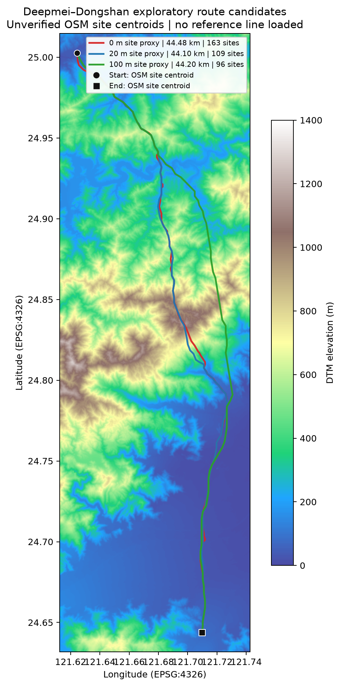

# 塔址成本敏感性服务器复测

日期：2026-10-29
服务器：`benke@10.166.33.23`，工作目录 `/data1/B24041626/pp/tower_site_cost_ablation_20261029`
代码提交：`68b76dddfcce27ca84bb34883ad09ad01c474042`

## 范围

在同一条深美—冬山探索性站间任务上，只改变塔址软成本代理的等效距离：0、20、100 米。三次规划都没有加载真实线路几何，线路之间的距离仅表示参数敏感性，不能当成真实线路误差或 5% 达标率。

起终点是 OpenStreetMap 站区质心，坐标未经线路侧接入点核验。公开的 53.5 km 光纤区间长度没有作为输电线路长度或几何真值。

## 输入与固定参数

- DEM：`/data1/B24041626/pp/dtm_2026_planner_input_20261028_01/dtm_2026_20m_geographic_4326.tif`，约 20 m，EPSG:4326。
- 站点与任务：`/data1/B24041626/pp/deepmei_dongshan_station_site_exploratory_20m_20261029/`。
- 官方约束：`/data1/B24041626/pp/work/data/official_constraints_20261023.geojson`。
- 陆域掩膜：`/data1/B24041626/pp/landmask_route_fix_20261026/inputs/county_boundaries_1140318.geojson`。
- 官方灾害：`/data1/B24041626/pp/work/data/official_sources/ardswc_115_mvt_z10_20261023`。
- 人口：WorldPop 2025 100 m 栅格，NoData 策略 `maximum`；此次规划窗口人口栅格覆盖率约 34.4%，路线人口覆盖并不完整。
- OSM 缓存：`/data1/B24041626/pp/work/osm`。建筑与土地利用是观测到的要素，完整覆盖未核实。
- 代价权重：官方灾害 1.0、OSM 聚落 2.0、人口 1.0、TPI 脊线 0.1、地形坡度 0.75、粗糙度 0.25；相邻地面坡度与转弯惩罚均为 0。
- 网格最长边 6400，搜索窗口外扩 0.3°；塔位图档距参数为最小 0 m、最大 500 m，候选步长 4（20 m DEM 上名义约 80 m）。这两个档距数值只是实验参数，不是工程限值。

塔址代理按“当地跨距阻力 × 等效距离”计入实验塔位图搜索目标。20/100 m 不是造价估计、规范或经校准的工程参数。普通 A* 基线在三次任务中均为 46.655 km。

## 结果

| 塔址代理等效距离 | 塔位路线长度 | 中间塔位 | 跨数 | 跨距中位数 | 跨距范围 | 跨距阻力积分* | 塔位图耗时 |
|---:|---:|---:|---:|---:|---:|---:|---:|
| 0 m | 44.479 km | 163 | 164 | 254.14 m | 79.02–489.49 m | 217,613.313 | 1,043.8 s |
| 20 m | 44.096 km | 109 | 110 | 432.45 m | 80.51–489.49 m | 218,776.349 | 1,094.6 s |
| 100 m | 44.199 km | 96 | 97 | 467.37 m | 241.52–489.49 m | 221,060.278 | 1,132.7 s |

三次运行均为 `run_summary.complete=true`、1/1 用例完成。当前编码的栅格硬约束复核与设定档距复核通过；塔址坡度未评估、塔基平台半径未设置、导线净空未请求，塔位灾害暴露仅是中心像元诊断。因此这些“通过”不代表工程可建或线路设计审查通过。

\* `path_cost_integral.total_cost_meter` 是跨距代价积分，不包含这里新增的塔址代理项，不能据此比较三次搜索的完整目标值。

路线间以 EPSG:3826 投影后按 40 m 间距采样，得到以下规划敏感性（不是对真实线路的误差）：

| 路线对 | 对称采样 P95 距离 | Hausdorff 距离 |
|---|---:|---:|
| 0 m vs 20 m | 198.9 m | 441.2 m |
| 0 m vs 100 m | 2,843.4 m | 3,088.3 m |
| 20 m vs 100 m | 2,841.6 m | 3,088.3 m |

本图使用 20 m DEM 作地形底图；三条线是规划候选，黑色圆点和方点是未核验站区质心。没有加载真实输电线路。

## 解释与限制

- 随塔址代理权重上升，塔位数从 163 降到 109、再到 96，说明代理项确实改变了塔位图的选路结果；路线长度没有单调变化。
- 100 m 方案相对 0/20 m 方案有约 2.84 km 的路线间对称 P95 偏离。这个变化只说明目标函数敏感，不能说明 100 m 更接近实际线路。
- 最小档距设为 0 m，最大档距 500 m，且约 80 m 候选间距会影响可达性。需要获得对应线路的工程参数后，才能设置可审查的档距、塔址坡度、塔基平台和净空条件。
- 真实线路几何与独立核验的站端接入点仍缺失；因此本复测无法判断“与实际线路误差是否低于 5%”。
- 三次路线输出的 SHA-256、逐次指标及路线间距离见 [`route_pairwise_sensitivity_final.json`](route_pairwise_sensitivity_final.json)。服务器保留了完整 GeoJSON、日志、摘要和溯源文件。

## 运行与验证记录

- 三次有效结果目录分别为 `results_site_cost_0m_retry1`、`results_site_cost_20m_retry1`、`results_site_cost_100m_retry1`。
- 0 m 首次尝试因陆域掩膜文件名笔误在开始搜索前失败；`results_site_cost_0m` 原样保留。20 m 启动日志 `results_site_cost_20m` 也保留；它不是有效结果，表格只使用 `_retry1` 目录。
- 服务器只读资源检查：96 个逻辑 CPU、251 GiB RAM；规划进程约占 1 个 CPU 核，峰值观测 RSS 约 10 GiB；GPU 未使用。A* 和塔位图搜索当前为 CPU 路径。
- 服务器手工断言验证了代理栅格值、非法参数拒绝、硬掩膜穿越与高塔址成本规避。该 venv 未安装 `pytest`，所以没有运行完整 pytest 套件。
- 关键源码 SHA-256：
  - `transmission_path_planner/cli.py`：`040b6a3f15eeb3e1b3d06185425746875a0247f3c65047f2c151b52e6f512761`
  - `transmission_path_planner/experimental_tower_graph.py`：`26f63c05b7444fa7c0427bd38bded7e904acbd0e736847b5c6cb7d2fa858114a6`
  - `tests/test_experimental_tower_graph.py`：`cdadc908036ed19ddaf60af4920374bf670e4250cd9542639b6b04dfb1d2fffd`
