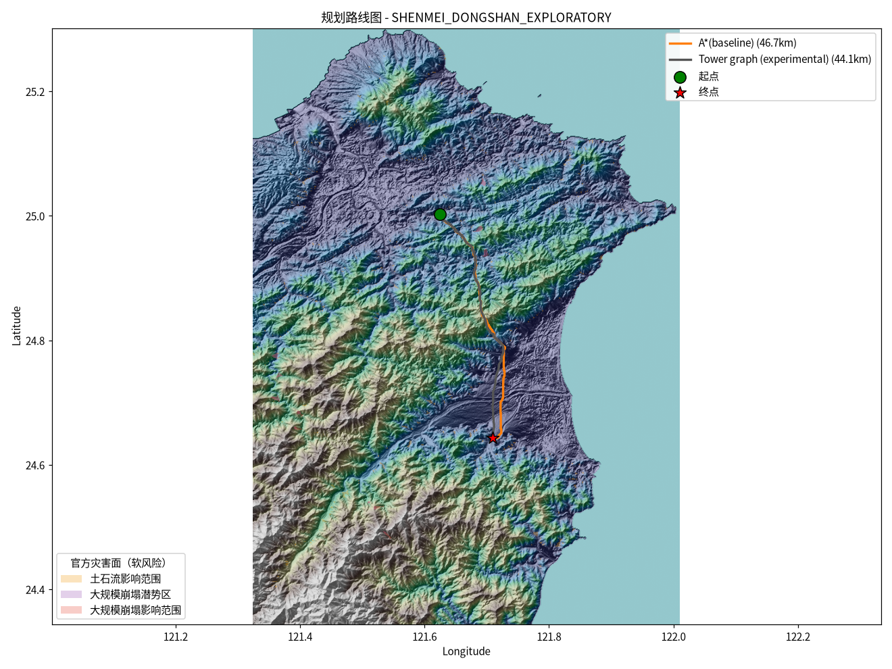

# 塔位图搜索目标成本诊断复跑

日期：2026-10-29

服务器：`benke@10.166.33.23`

新建工作目录：`/data1/B24041626/pp/tower_site_objective_diagnostic_20261029`

结果目录：`/data1/B24041626/pp/tower_site_objective_diagnostic_20261029/results_20m_objective_diagnostic`

代码基线：`6c626936c879af77efb3212fcfca0a35e4233d6e`，本次三份工作文件另见下方 SHA-256。

## 目的

修正塔位图搜索指标：将搜索原始路径的跨距积分、塔址代理成本和转弯惩罚分开导出，并与端点恢复后的路线几何指标分开标注。本次没有修改选路参数；只在服务器重新运行相同的深美—冬山探索任务，检查指标能否复现。

## 运行结果

- 批次完整：`complete=true`，1/1 案例完成，无失败或无路线案例。
- 使用 20 m DEM、`max-side=6400`、档距参数 0–500 m、塔位候选步长 4、塔址代理等效距离 20 m；这些档距和代理距离是实验参数，不是工程设计值。
- A* 基线路线：46.655 km，搜索用时约 127.4 s。
- 塔位图候选：44.096 km，111 个节点（109 个中间塔位、110 跨），搜索用时 1133.8 s。
- 塔位图原始搜索目标成本（`cost_meter`）：

  | 分量 | 数值 |
  |---|---:|
  | 跨距代价积分 | 218,776.349236 |
  | 塔址成本代理 | 9,924.447544 |
  | 转弯惩罚 | 0 |
  | 合计 | 228,700.796780 |

  分量合计相符。`path_cost_integral.total_cost_meter` 仍只表示跨距积分，不含塔址代理项；不能把它当作完整搜索目标值。
- 默认最终选择仍是 A* 基线。塔位图仅作实验候选，候选校验状态为 `site_slope_not_evaluated`。
- 服务器总运行时间约 1308.9 s；`ps` 采样中 CPU 约 1 核，RSS 最高观测约 10.1 GiB；没有使用 GPU。OSM 缓存先复制进本次新目录，未让规划进程写回共享缓存。

本次塔位图候选 GeoJSON SHA-256 与此前 20 m 运行相同：
`29d66287a405586fd49d4d696482eb9db09b0f703fbf02b0074d306b00284087`。A* 最终路线坐标序列 SHA-256 也与旧运行相同：
`88d8227ec5902d1b483596f1e470615918e499f7d783e7d56ad355617551d440`。文件元数据可能因输入缓存路径不同而变化，但路线坐标保持一致。

## 不能从本次结果推出的结论

未加载真实输电线路几何，`real_evaluation` 为 `not_requested`；站端是未核验的 OSM 站区质心。因而本次不能计算实际线路误差，也不能声称达到 5% 或任何真实线路贴合率。

本次仅复核加载的栅格硬约束。塔址坡度未评估、塔基平台半径未配置、导线净空未请求，DEM 垂直基准未标注；工程可行性为 `not_evaluated`。20 m 塔址代理是“当地跨距代价 × 20 m”的未校准敏感性参数，不是造价估算、规范或台电设计参数。

## 关键输入哈希

| 输入 | SHA-256 |
|---|---|
| 20 m DTM | `661bee946235602398c67a46cc76d1180952ccc52d104b73b481b57d9a557fbe` |
| 站点表 | `f7cc6d05a916c636f614a9dca6c9a852c83089b5f5eee6948f0358696e34f631` |
| 站间任务表 | `405594dcb12914b6ac5cfbeb77e7764eac72e4435076862a523bf1d1e0704f2a` |
| 项目硬约束 | `5967d659856b925cd42909a6b5e1cf4ac09ae808d6d1c8e7ecd851003fa530b5` |
| 台湾县市陆域边界 | `7e3d24cb13b7f1125c1c967d9d436ee556567516b0eb9894cfa3e763fe8874dd` |
| WorldPop 栅格 | `e963266859c6aa03c4e015e79bd62cceb1800a894a1d84e6bfe4748eb2cd7e75` |

## 本次代码文件哈希

| 文件 | SHA-256 |
|---|---|
| `transmission_path_planner/cli.py` | `2f364ae5a2529ae687c4cafb1c6c30275748c28d2e971be204777f675ba02f82` |
| `transmission_path_planner/experimental_tower_graph.py` | `b41da35eaefee3cf287caebb64261c87ad0a9eb11cdc9ed1c0bb959484f33bb1` |
| `tests/test_experimental_tower_graph.py` | `8f2ae67a000c729764c7a5ea122d244cb0549e654bb0f0c84368c095b3f380ab` |

原始 `run_summary.json`、`run_provenance.json`、`comparison_metrics.json`、最终路线与实验候选 GeoJSON、路线对比图均随本目录保存。路线搜索只在上述服务器目录中运行；本机运行的是合成单元测试和前端 API 单元测试。
