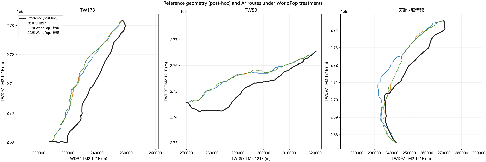

# WorldPop 年份配对敏感性试验

## 结论

使用相同 A* 配置，对 TW173、TW59、天輪~龍潭線分别运行关闭人口代价、WorldPop 2020 和 WorldPop 2025（人口权重均为 1）三种处理，共 9 次单案例运行。每个 run summary 都为 1/1 完成、无失败、无无路路线，最终路线硬约束违规数均为 0。

WorldPop 2025 与 2020 的路线指标整体接近，年份更新没有带来可重复的几何贴合提升。相对关闭人口代价，2025 处理组的中位对称 P95 从 8.95 km 降为 8.22 km，但中位 F1@100m 从 1.84% 降为 1.48%；逐线结果方向不一致：P95 在 TW173、TW59 变差，在天輪~龍潭線变好。三线样本不足以宣布总体提升，且历史线只用于规划后的评分，不能据该分数选择人口年份或权重。

因此本试验**不把人口层设成默认路线代价**。2025 WorldPop 可以作为显式启用的人口暴露软筛查；其栅格是模型估算，部分路线像元缺失，路线有效覆盖约 77.9%–88.2%。未知像元的最大代价策略是保守惩罚，不是人口观测值。建筑、许可区和输电工程要求仍需更具体、经核验的空间数据。

## 配对指标

P95 为规划路线与参考线路双向距离分布的对称 95 分位；F1 为双向线路长度采样覆盖率的调和平均。人口覆盖率按路线触及栅格单元计数，不按线路长度加权。

| 案例 | 人口处理 | P95 (km) | F1@100m | F1@500m | F1@1km | 长度差 (%) | 人口有效覆盖 | 最大采样地面坡度 (%) |
|---|---|---:|---:|---:|---:|---:|---:|---:|
| TW173 | 关闭 | 5.395 | 1.844% | 3.613% | 6.148% | 4.797 | — | 78.84 |
| TW173 | 2020 | 6.030 | 1.482% | 3.183% | 5.871% | 3.665 | 88.2% | 80.36 |
| TW173 | 2025 | 6.029 | 1.480% | 3.231% | 5.941% | 3.492 | 87.8% | 80.32 |
| TW59 | 关闭 | 8.954 | 2.374% | 7.558% | 13.867% | 3.701 | — | 87.93 |
| TW59 | 2020 | 9.088 | 3.186% | 7.948% | 13.998% | 2.213 | 77.9% | 70.80 |
| TW59 | 2025 | 9.090 | 3.651% | 7.965% | 14.000% | 2.232 | 77.9% | 70.80 |
| 天輪~龍潭線 | 关闭 | 9.340 | 1.466% | 10.753% | 14.249% | 8.385 | — | 144.09 |
| 天輪~龍潭線 | 2020 | 8.336 | 1.030% | 6.528% | 17.897% | 5.998 | 80.5% | 122.08 |
| 天輪~龍潭線 | 2025 | 8.224 | 1.352% | 6.748% | 12.650% | 5.961 | 80.6% | 122.08 |



地面坡度为 DEM 路线采样值，不是导线纵断面、塔位倾斜或工程安全判定。线路比较端点取自历史测试线路，故本试验是固定端点下的探索性对照，不是已核验的变电站间工程评测。三条线路的 100m F1 均低于 4%，没有达到用户此前提出的 100m 高贴合目标。

## 数据与复现

- 源代码：提交 `2ae6e86d3dccf8e6c79caad7683ad5600df32c17`；9 个运行均记录干净工作树。
- DEM：`data/taiwan_dem_35m_georef_fixed.tif`，`--max-side 1024`；本次有效像元约 106–134m。其垂直基准未核验。
- 2020 / 2025 人口：`data/external_sources/worldpop_twn_2020_100m_r2025a/`；STAC、许可和文件 SHA-256 见同目录 README 与 `SHA256SUMS.txt`。
- 共同规划输入包括同一端点任务、OSM 缓存、官方灾害瓦片和固定参数；参考线路只进入规划后评估。脚本逐批验证完成状态、工作树、代码提交、参考几何哈希、共同规划输入和配置差异。
- 重建 CSV、JSON 和叠图：

```powershell
D:\python\python.exe scripts\summarize_worldpop_vintage_comparison.py
```

汇总文件为 `metrics.csv`、`summary.json`、`route_comparison.png`。规划输出和每次运行的 provenance 留在被 `.gitignore` 排除的 `outputs/worldpop_isolated_*` 中。

第一次尝试在同一 Python 进程内连续运行 8 条无人口基线时发生 NumPy 内存分配失败（仅 2/8 完成；其余案例失败或未生成路线图），该批次被标记为不完整并**没有纳入上述分析**。最终 9 次配对运行改为每个案例单独启动进程，均成功。

之后在 CLI 每案例 `finally` 阶段释放大型栅格/矢量对象并执行垃圾回收，再用同一 8 案例命令复测。复测完成 6/8：TW252 因起点命中 OSM 建筑像元而被预期拒绝；TW173 出现资源分配失败，其错误字符串为空；另外 6 条成功路线全部导出，进程工作集约稳定在 2.6–2.8 GB，未随案例数连续上升。随后将 TW173 作为独立任务重跑成功，指标与原成功基线一致，说明该失败至少部分受当时的可用内存影响。相比原运行 2/8，逐案释放处理降低了多案例连续运行的内存累积，但尚未保证大范围 OSM 栅格化在内存紧张时总能成功。该 6/8 批次和 TW173 独立重跑都是脏工作树诊断运行，不纳入上面的三臂配对指标。CLI 现已改为在 run summary 中至少保留异常类型，后续复测可诊断空消息异常；需要后续在资源充足环境中重跑原批次确认。
