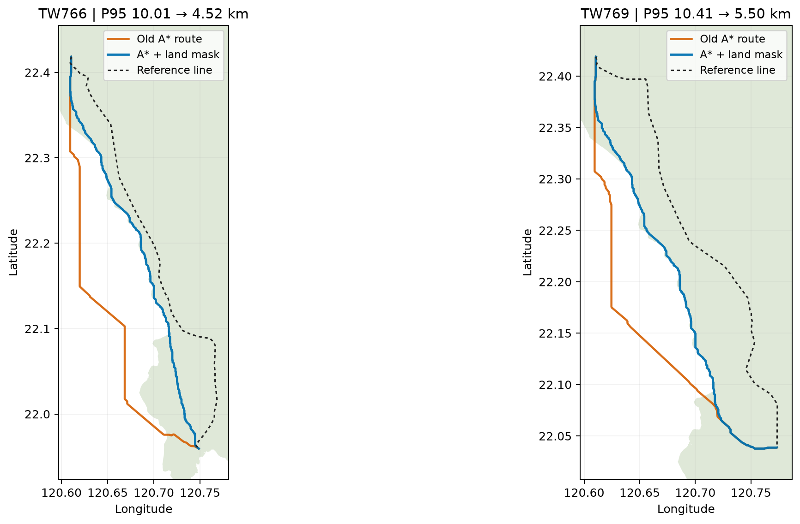

# 陆域硬约束回归记录（2026-10-26）

## 发现

在前一轮 12 条线路基线中，TW766 和 TW769 的规划线大量落在官方县市行政边界之外。对这两条线做空间筛查时，基线分别有 77.147% 和 62.561% 的线路长度在县市多边形外；相应真实线路参考为 0%。这是明显的跨海/越界信号，但行政区界不是测绘海岸线，不能据此判定每个外部点都是水域。

数据采用内政部国土测绘中心发布的 1140318 直辖市、县市界线 GeoJSON。数据可从[政府资料开放平台](https://data.gov.tw/dataset/7442)获取，页面标注免费及政府资料开放授权条款第 1 版。

本地数据文件 SHA-256：`7e3d24cb13b7f1125c1c967d9d436ee556567516b0eb9894cfa3e763fe8874dd`（10,172,081 字节）。

## 修改

- 新增可选 `--land-mask-geojson`，接受 WGS84 GeoJSON `Polygon`/`MultiPolygon`；多边形内部像元中心可通行，外部像元进入硬约束掩膜。
- 使用像元中心判定，避免 `all_touched` 把与边界相碰的海域像元误放行。
- 对各组成部分本身有效、但因嵌套或重叠而整体无效的 `MultiPolygon` 执行溶解；无法安全修复时停止并报错。
- 数据路径、要素数、修复记录和栅格化语义写入运行指标及输入来源记录。未传入参数时，规划器保持原有默认行为。

## 两条沿海样本复测

同一 DEM、成本参数、OSM 缓存和官方灾害/约束数据下，关闭 AI/PPO/VIN，分别重跑基线、8 邻域共享目标和 16 邻域共享目标。

| 线路 | 基线在行政区界外长度占比 | 加陆域掩膜后的基线 | 双向 P95（旧 → 新） |
|---|---:|---:|---:|
| TW766 | 77.147% | 0.005% | 10.008 → 4.516 km |
| TW769 | 62.561% | 0.005% | 10.411 → 5.496 km |

16 邻域新路线在县市多边形外的长度占比为 TW766 0.013%、TW769 0.015%。两条样本合并后，基线双向 P95 中位数由 10.209 km 降至 5.006 km，F1@1 km 中位数由 6.56% 升至 13.90%。这只是两条沿海线路的试验结果，不能代表全体线路；误差仍为公里级，未达到 100 米目标。

## 12 条线路批次状态

12 条共享基线/8 邻域/16 邻域批次在服务器 `/data1/B24041626/pp/landmask_route_fix_20261026/output_12case` 运行。最后一次能连接服务器时，11/12 条已写入比较指标，任务进程仍占用约 1 个 CPU 核心、RSS 约 3.8 GiB。之后 SSH 连接超时，因此整批最终状态和资源统计尚未核实；在恢复连接并读取 `run_summary.json` 前，不把这批数据当作已完成结果。

这组任务使用历史参考折线首尾坐标作为固定端点，没有传入 `stations.csv` 或 `route_tasks.csv`，所以它是候选路线形状实验，不是经核验的变电站站间规划，也不证明工程可建性。公开站点数据缺口和后续评测准入条件见[站间规划端点数据缺口审计](台电站间规划端点数据缺口审计_20261027.md)。

本批次运行在服务器用户目录下，没有管理员命令，也没有触碰 `/data1/B24041626/pp` 以外的服务器数据。CPU A* 运行未占 GPU；先前只读快照显示四张 RTX 4090 的显存均接近占满，因此没有尝试切换到 GPU。

## 额外数据候选

国土测绘中心提供免申请 WMS/WMTS 及图层查询，含国土利用现况调查成果图；WFS 向量服务和国土利用调查 API 需要符合资格的单位申请。[服务说明](https://maps.nlsc.gov.tw/S09SOA/pro/intro.jsp)及[官方 WMS 说明](https://maps.nlsc.gov.tw/S09SOA/pro/Wms_ajax_main.jsp)列出了这些服务。已取回一个建成区分类样图，但水利用地分类图层请求超过 30 秒；该图层尚未转成可验证的成本栅格，因此未加入本轮规划。内政部 115 年度更新图幅只覆盖部分地区，应用前还需核对每条样本的更新覆盖范围。[115 年度第一批更新公告](https://www.moi.gov.tw/News_Content.aspx?n=2&s=341036)

## 自检

- 陆域掩膜 3 项单元测试在服务器环境中通过。
- 本机 `D:\python\python.exe -m pytest -q` 通过：366 项测试及 93 个子测试；陆域掩膜与命令行参考独立性测试合计 80 项及 18 个子测试通过。
- `py_compile` 和 `git diff --check` 通过。新增 CRS 测试确认接受 OGC CRS84 常见写法，并拒绝误匹配的 `EPSG:43260`。
- 需在服务器恢复后完成 12 条批次取回、汇总、边界外比例统计及资源记录，再更新本文。
