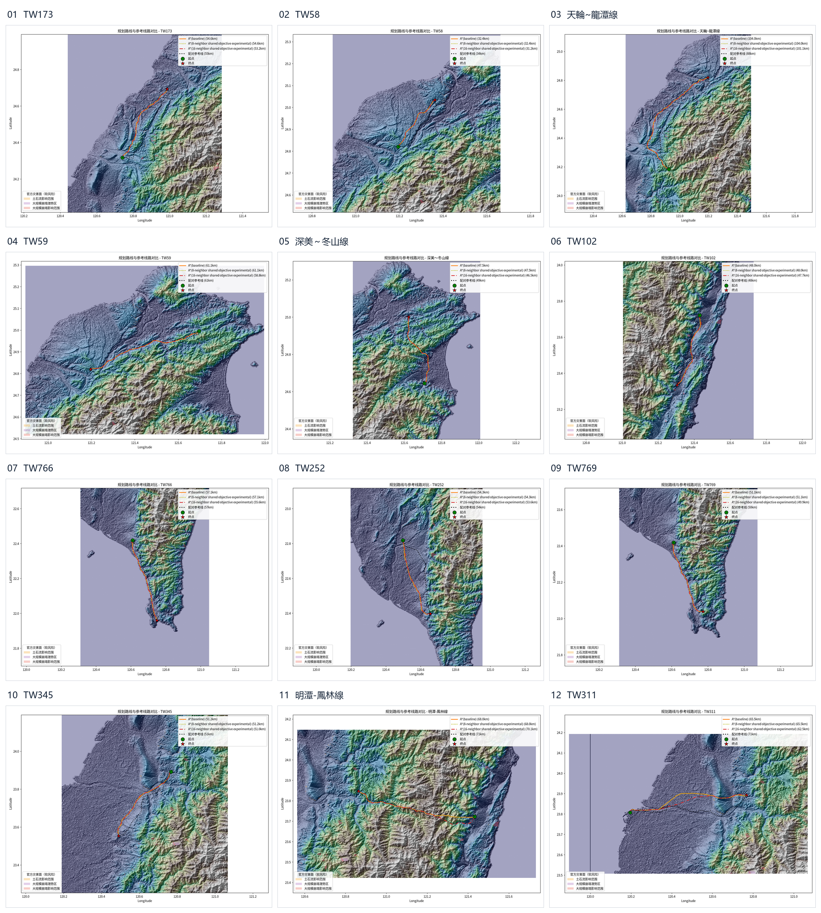
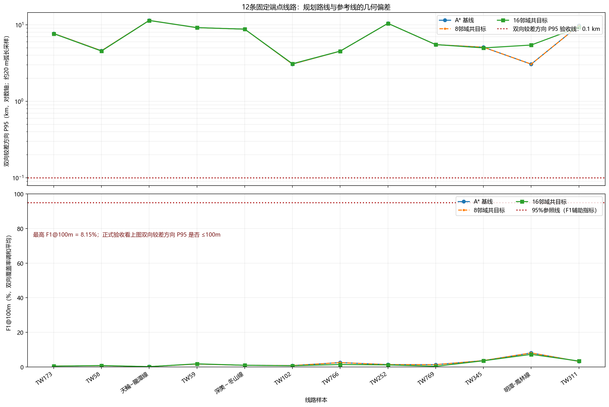

# 陆域硬约束回归记录（2026-10-26）

## 发现

在前一轮 12 条线路基线中，TW766 和 TW769 的规划线大量落在官方县市行政边界之外。对这两条线做空间筛查时，基线分别有 77.147% 和 62.561% 的线路长度在县市多边形外；相应真实线路参考为 0%。这是明显的跨海/越界信号，但行政区界不是测绘海岸线，不能据此判定每个外部点都是水域。

数据采用内政部国土测绘中心发布的 1140318 直辖市、县市界线 GeoJSON。数据可从[政府资料开放平台](https://data.gov.tw/dataset/7442)获取，页面标注免费及政府资料开放授权条款第 1 版。

本地数据文件 SHA-256：`7e3d24cb13b7f1125c1c967d9d436ee556567516b0eb9894cfa3e763fe8874dd`（10,172,081 字节）。

## 修改

- 新增可选 `--land-mask-geojson`，接受 WGS84 GeoJSON `Polygon`/`MultiPolygon`；多边形内部像元中心可通行，外部像元进入硬约束掩膜。
- 使用像元中心判定，避免 `all_touched` 把与边界相碰的海域像元误放行。
- 对各组成部分本身有效、但因嵌套或重叠而整体无效的 `MultiPolygon` 执行溶解；无法安全修复时停止并报错。
- 数据路径、要素数、修复记录和栅格化语义写入运行指标及输入来源记录。未传入参数时，规划器保持原有默认行为。

## 两条沿海样本复测

同一 DEM、成本参数、OSM 缓存和官方灾害/约束数据下，关闭 AI/PPO/VIN，分别重跑基线、8 邻域共享目标和 16 邻域共享目标。

| 线路 | 基线在行政区界外长度占比 | 加陆域掩膜后的基线 | 双向 P95（旧 → 新） |
|---|---:|---:|---:|
| TW766 | 77.147% | 0.005% | 10.008 → 4.516 km |
| TW769 | 62.561% | 0.005% | 10.411 → 5.496 km |

16 邻域新路线在县市多边形外的长度占比为 TW766 0.013%、TW769 0.015%。两条样本合并后，基线双向 P95 中位数由 10.209 km 降至 5.006 km，F1@1 km 中位数由 6.56% 升至 13.90%。这只是两条沿海线路的试验结果，不能代表全体线路；误差仍为公里级，未达到 100 米目标。

## 12 条线路批次最终结果

服务器批次 `/data1/B24041626/pp/landmask_route_fix_20261026/output_12case` 已于 2026-10-26T15:31:30+00:00 完成（启动：2026-10-26T14:36:55+00:00）。`run_summary.json` 为 `complete=true`，12/12 完成、0 失败、0 无路可达；每条均产出基线、8 邻域共目标和 16 邻域共目标的后验对照。服务器结果文件已只读取回到本地忽略目录 `outputs/landmask_route_fix_20261026/server_output_12case/`，12 张逐线对照图均与服务器 provenance SHA-256 一致。

规划只读固定端点 CSV、35 m DEM、硬约束、县市陆域掩膜、官方灾害图层以及缓存的 OSM 建筑/土地利用要素；`run_provenance.json` 中的参考线路路径属于评测配置，参考几何在路线生成后用于对照。历史线路没有作为搜索走廊或代价先验。该批次仍以参考线路首尾点作为端点，CSV 来源和端点作为真实站点的有效性均未核验。

| 方法 | 双向较差方向 P95 中位数 | 双向较差方向 P95 均值 | F1@100m 中位数 / 均值 | 长度差中位数 | P95 逐线变化 |
|---|---:|---:|---:|---:|---:|
| A* 基线 | 6.593 km | 6.917 km | 1.38% / 2.12% | 1.78% | — |
| 8 邻域共目标 | 6.593 km | 6.917 km | 1.38% / 2.12% | 1.78% | 12/12 与基线指标完全一致 |
| 16 邻域共目标 | 6.579 km | 7.062 km | 1.10% / 1.88% | 3.03% | 6 条较低、5 条较高、1 条近似不变；中位数仅低 14.8 m，均值反而增加 145 m |

逐线结果（16 邻域与 A* 基线比较；8 邻域逐项与基线相同）：

| 线路 | P95 基线 (km) | P95 16 邻域 (km) | 差值 (m) | F1@100m 基线 | F1@100m 16 邻域 |
|---|---:|---:|---:|---:|---:|
| TW173 | 7.691 | 7.650 | -41 | 0.55% | 0.48% |
| TW58 | 4.573 | 4.535 | -38 | 0.78% | 0.86% |
| 天輪~龍潭線 | 11.404 | 11.373 | -31 | 0.22% | 0.21% |
| TW59 | 9.157 | 9.182 | +26 | 1.72% | 1.84% |
| 深美～冬山線 | 8.761 | 8.761 | -0.02 | 0.99% | 1.00% |
| TW102 | 3.062 | 3.093 | +32 | 0.83% | 0.73% |
| TW766 | 4.516 | 4.525 | +9 | 2.56% | 1.44% |
| TW252 | 10.430 | 10.426 | -5 | 1.39% | 1.19% |
| TW769 | 5.496 | 5.507 | +11 | 1.37% | 0.40% |
| TW345 | 5.090 | 4.983 | -107 | 3.70% | 3.61% |
| 明潭-鳳林線 | 3.056 | 5.432 | +2377 | 8.15% | 7.31% |
| TW311 | 9.773 | 9.277 | -496 | 3.25% | 3.45% |

### 县市多边形外线路长度复核

将服务器输出的 12 组 `paths.json` 与 12 条参考 `real_route.geojson` 按本地等距方位投影，和溶解后的国土测绘中心县市多边形做线长相交复核；输入边界 SHA-256 与运行 provenance 中记录的 `7e3d24cb...fe8874dd` 一致。参考线路全部在县市多边形内。规划路线统计如下：

| 方法 | 县市多边形外长度占比中位数 | 均值 | 最大值 | 超过 0.01% 的线路数 |
|---|---:|---:|---:|---:|
| A* 基线 | 0% | 0.00085% | 0.00538% | 0/12 |
| 8 邻域共目标 | 0% | 0.00085% | 0.00538% | 0/12 |
| 16 邻域共目标 | 0% | 0.00236% | 0.01496% | 2/12 |

超过 0.01% 的两条为 TW766（基线 0.00481%、16 邻域 0.01341%）和 TW769（基线 0.00538%、16 邻域 0.01496%）。县市界不是测绘海岸线，因此这里表示“在县市多边形外的几何长度”，不能直接解释为入海长度或实际越界；16 邻域的较长步幅也让少量线段穿过了多边形边缘。它确认陆域掩膜显著消除了原先的大范围越界现象，但不能证明海岸级精度。

这里的双向较差方向 P95 是规划→参考、参考→规划两方向 P95 的较大值，按约 20 m 弧长采样估计；它直接对应“双向各至少95%线路长度落在100 m内”的验收条件。F1@100m 是两方向覆盖率的调和平均，只作辅助诊断。12 条基线的较差方向 P95 范围为 3.056–11.404 km，16 邻域为 3.094–11.373 km；0/12 达到 100 m。基线最高 F1@100m 只有 8.15%，16 邻域最高 7.31%，与目标相距很大。16 邻域只带来很小且不稳定的 P95 变化，同时平均 F1@100m 由 2.12% 降到 1.88%；不应据此认定其更贴近真实线路。

## 批次资源与边界

- 运行耗时 54 分 38 秒，CPU 使用率 100%（约 1 个核心），峰值 RSS 4,155,280 kB（约 3.96 GiB），Swap 为 0，退出码为 0。
- 这是 CPU A* 搜索；GPU 未参与。未发送管理员命令，服务器侧只在 `/data1/B24041626/pp` 内运行和读取。
- 使用 `max_side=4096`、35 m Terrarium 派生 DEM（垂直基准未知）、0.3° 搜索边界；未启用 PPO/VIN。县市边界仅作为陆域硬掩膜的近似，不能等同精确海岸线；OSM 要素只代表已映射对象。
- 没有 `stations.csv` 或 `route_tasks.csv` 输入；塔位间距、导线弧垂、对地/对建筑净空、塔高、风荷载等工程参数未配置。这是固定坐标的地形约束算法比较，不是经核验的变电站站间方案，也不构成工程可建性证明。
- 公开站点数据缺口和后续评测准入条件见[站间规划端点数据缺口审计](台电站间规划端点数据缺口审计_20261027.md)。
- 长度接近不等于走向接近；本批几何差仍为公里级。仅靠地形和现有约束无法辨识历史线路的既有走廊、用地协调、规划审批和运维因素。下一轮应优先补可追溯的真实站点/端点、官方线路走廊或塔位、完整保护区与工程边界；无法取得这些信息时，把目标限定为可解释的低成本候选线，不承诺复刻历史线。

这一批运行没有通过历史折线引导规划；引用参考折线只用于路线冻结后的误差评估。

## 额外数据候选

国土测绘中心提供免申请 WMS/WMTS 及图层查询，含国土利用现况调查成果图；WFS 向量服务和国土利用调查 API 需要符合资格的单位申请。[服务说明](https://maps.nlsc.gov.tw/S09SOA/pro/intro.jsp)及[官方 WMS 说明](https://maps.nlsc.gov.tw/S09SOA/pro/Wms_ajax_main.jsp)列出了这些服务。已取回一个建成区分类样图，但水利用地分类图层请求超过 30 秒；该图层尚未转成可验证的成本栅格，因此未加入本轮规划。内政部 115 年度更新图幅只覆盖部分地区，应用前还需核对每条样本的更新覆盖范围。[115 年度第一批更新公告](https://www.moi.gov.tw/News_Content.aspx?n=2&s=341036)

## 自检

- 陆域掩膜 3 项单元测试在服务器环境中通过。
- 本机 `D:\python\python.exe -m pytest -q` 通过：366 项测试及 93 个子测试；陆域掩膜与命令行参考独立性测试合计 80 项及 18 个子测试通过。
- `py_compile` 和 `git diff --check` 通过。新增 CRS 测试确认接受 OGC CRS84 常见写法，并拒绝误匹配的 `EPSG:43260`。
- 服务器批次已核实 12/12 完成、0 失败、0 无路可达；已取回并校验 12 张路线对照图 provenance 哈希，完成逐线误差表、资源记录和总览图。
