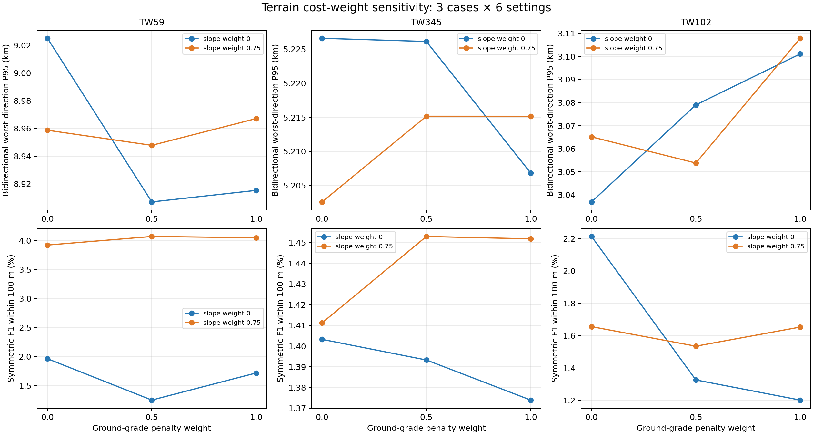
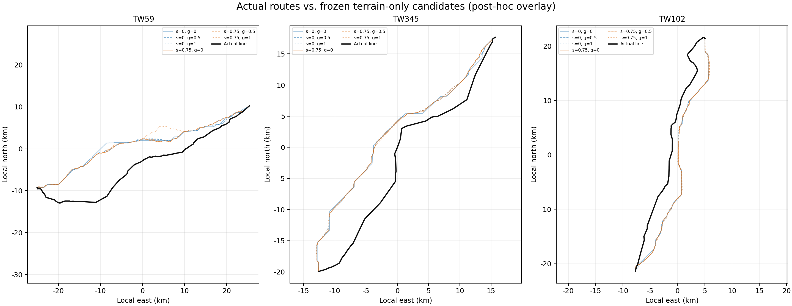

# 35 m 地形代价权重消融：18 组结果

## 结论

本轮完成 3 个固定端点案例、每例 6 组地形坡度与地面坡度代价组合，共 18 个规划候选。候选规划期间没有读取真实线路几何；18 条候选冻结并校验哈希后，才加载真实线路计算误差。

没有候选达到“至少 95% 线路长度处于真实线路 100 m 内”的目标：双向较差方向 P95 最小仍为 **3.037 km**，中位数 **5.215 km**，最大 **9.025 km**。18 条候选的 100 m 对称 F1 平均为 **1.947%**，没有一条 P95 小于等于 100 m。所有候选的硬约束检查均通过，但这只表示已加载约束下没有检测到冲突，不等于工程可行性审查完成。

这次权重变化能改变路线穿过的地形，却没有消除与真实路线的公里级偏离。长度误差也不能代表路线贴合度：例如 TW345 六个候选的长度差均不超过 1.20%，P95 仍约为 5.20–5.23 km。继续只调这两个权重没有证据能把误差降到目标内。

## 误差图

图中 P95 是规划线到真实线、真实线到规划线两个方向的 P95 中较差者。F1 是两个方向在 100 m 容差下覆盖率的调和平均。

完整的 18 行指标见 [CSV](evidence/terrain_cost_weight_ablation_20261027/posthoc_metrics_v6.csv)；原始 v6 评分见 [JSON](evidence/terrain_cost_weight_ablation_20261027/posthoc_metrics_v6.json)。

## 逐组结果

| 案例 | 坡度权重 | 地面坡度权重 | 双向较差方向 P95 (km) | F1@100 m (%) | 长度差 (%) | 路线地表坡度 P90 (°) | 硬违规 |
|---|---:|---:|---:|---:|---:|---:|---:|
| TW59 | 0 | 0 | 9.025 | 1.963 | 4.346 | 25.40 | 0 |
| TW59 | 0 | 0.5 | 8.907 | 1.250 | 3.157 | 24.60 | 0 |
| TW59 | 0 | 1 | 8.915 | 1.718 | 5.050 | 23.84 | 0 |
| TW59 | 0.75 | 0 | 8.959 | 3.924 | 4.278 | 18.96 | 0 |
| TW59 | 0.75 | 0.5 | 8.948 | 4.072 | 1.846 | 18.94 | 0 |
| TW59 | 0.75 | 1 | 8.967 | 4.051 | 0.782 | 17.12 | 0 |
| TW345 | 0 | 0 | 5.227 | 1.403 | 1.191 | 11.45 | 0 |
| TW345 | 0 | 0.5 | 5.226 | 1.393 | 0.206 | 9.77 | 0 |
| TW345 | 0 | 1 | 5.207 | 1.374 | 0.204 | 9.64 | 0 |
| TW345 | 0.75 | 0 | 5.203 | 1.411 | 0.074 | 8.44 | 0 |
| TW345 | 0.75 | 0.5 | 5.215 | 1.453 | 0.272 | 8.45 | 0 |
| TW345 | 0.75 | 1 | 5.215 | 1.452 | 0.114 | 8.31 | 0 |
| TW102 | 0 | 0 | 3.037 | 2.213 | 1.036 | 3.03 | 0 |
| TW102 | 0 | 0.5 | 3.079 | 1.326 | 0.637 | 2.67 | 0 |
| TW102 | 0 | 1 | 3.101 | 1.202 | 0.629 | 2.61 | 0 |
| TW102 | 0.75 | 0 | 3.065 | 1.656 | 0.802 | 2.49 | 0 |
| TW102 | 0.75 | 0.5 | 3.054 | 1.535 | 3.169 | 2.44 | 0 |
| TW102 | 0.75 | 1 | 3.108 | 1.653 | 1.118 | 2.44 | 0 |

坡度权重从 0 增至 0.75 后，18 组配对的地表坡度 P90 中位变化为 **−1.33°**，但路线误差 P95 中位只变化 **+7 m**，且不同案例和地面坡度权重下方向不一致。地形看起来更平缓，并没有带来更贴近历史线路的稳定收益。

## 实验设计与数据边界

- 案例 TW59、TW345、TW102 是从既有 12 组固定端点中，按端点包围框内 DEM 坡度 P90 选出的低、中、高地形样本；选取未使用路线误差。
- 输入包括 35 m DEM、县界陆域掩膜、官方灾害图层、约束 GeoJSON 与 OSM 建筑/土地利用缓存。人口层关闭。OSM 覆盖完整性未验证，不能将“未命中”解释为没有居民或建设用地。
- 每个案例固定其余参数，只变化 `terrain_slope_weight ∈ {0, 0.75}` 和 `grade_penalty_weight ∈ {0, 0.5, 1}`。规划在 CPU 上顺序运行，GPU 未参与。
- 原始端点坐标来自历史线路样本的端点，尚未独立核验为变电站线路侧接入点。规划器只接收起终点坐标，不接收沿途历史线路；因此这是固定端点基准，不是已经验证站点拓扑的规划结果。
- 当前地面坡度项是相邻 DEM 像元的地面高差代价，不是导线弧垂、塔高、档距或线路纵断面可行性模型。最大地面坡度不能当作输电工程坡度上限。
- P95/F1 使用 v6 双向线距指标，沿线 20 m 采样；这些是几何接近度指标，不替代电气、结构、用地审批或现场勘查。

输入 SHA-256、候选冻结记录、引用线路来源哈希、运行摘要及图表都保存在 [本轮证据目录](evidence/terrain_cost_weight_ablation_20261027/)。初次本地运行有两次失败，随后在服务器上各重试成功；服务器补跑的 9 项均返回 0，因此 18 个设置各有一份成功候选。失败尝试记录保留在本地运行摘要中。

## 下一轮工作顺序

优先核实三个案例的真实站点、线路侧接入点和线路拓扑，再扩大到 12 条线路。现在的端点只是历史折线端点，若它们与真实变电站接入位置不一致，继续调整路径代价无法形成有效的站间规划评估。站点核实可使用官方站点/电力设施数据；历史线路几何仍只用于候选冻结后的评估，不用于生成路线或挑选权重。

之后再单独测试转弯代价对路线平滑性的影响，并按工程可解释性冻结参数。转弯代价可能改善折线锯齿，不应预期它能单独解释当前数公里级走廊偏差。
