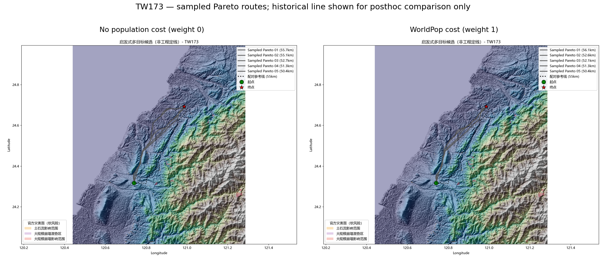
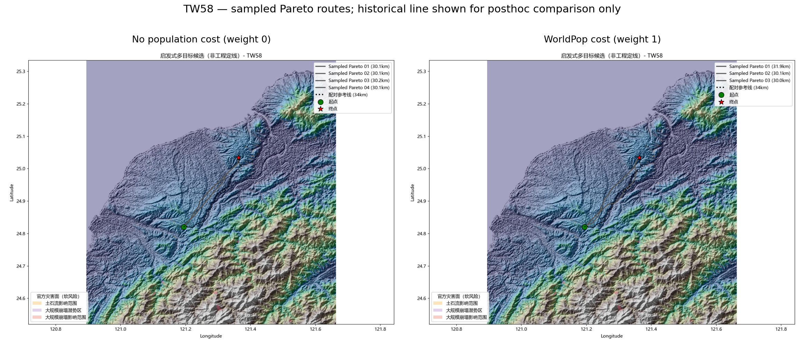
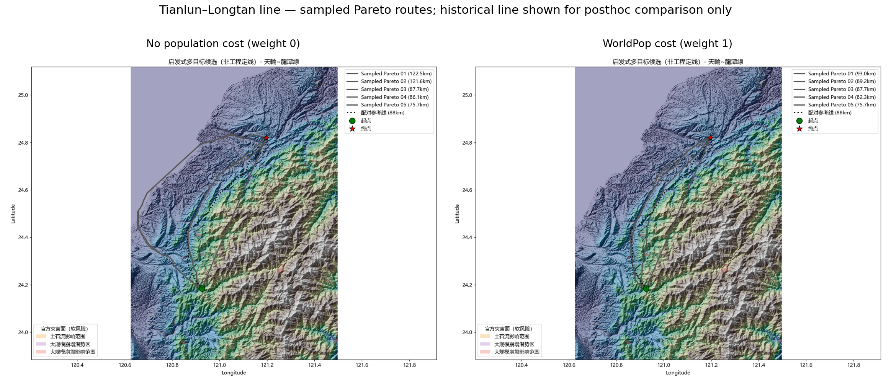

# 台湾输电线路三线路人口代价配对复测

> 复测日期：2026-10-24。该文档记录无历史线路先验的规划对照；历史线路仅用于规划完成后的评分和可视化。

## 结论

在同一干净源码提交 `7157d64`、相同 DEM、约束图层、任务端点和 A* 配置下，仅把 WorldPop 人口软成本从 0 调为 1，三条线路的平均双向 P95 偏差由 **12,826.5 m** 降至 **6,398.2 m**（下降 50.1%）；平均 F1@100m 由 **1.79%** 变为 **3.60%**。这说明人口代价在这组三线路上有敏感性信号，但还不能作为独立泛化结论：WorldPop 覆盖存在 NoData，端点来自历史线端点，且 OSM 建筑/用地层未加载。

最终路线选择仍采用正式 A*(baseline) 规则。Pareto 候选为实验性、不可选路线；按历史线事后挑出的最佳候选只作诊断上界，不能视作规划器成绩。

## 配对指标

| 线路 | 无人口 P95 (m) | 人口 P95 (m) | P95 变化 (m) | 无人口 F1@100m | 人口 F1@100m | 人口路线栅格有效率 |
|---|---:|---:|---:|---:|---:|---:|
| TW173 | 10,393.5 | 8,703.7 | -1,689.8 | 0.39% | 0.41% | 96.37% |
| TW58 | 3,744.7 | 2,315.5 | -1,429.2 | 4.78% | 7.16% | 96.20% |
| 天輪~龍潭線 | 24,341.3 | 8,175.3 | -16,166.1 | 0.19% | 3.22% | 92.61% |

人口路线栅格有效率按规划路线经过的栅格单元估算，不代表整个规划窗口的覆盖率。无效单元按最大归一化人口代理惩罚处理，会让路径受栅格覆盖边界影响。

## 配对设置与复现

- Git 提交：`7157d64c74fdb9a72e8352431aa2e9a0f52ce255`；两个运行均为干净工作树。
- 无人口运行耗时：643.0 秒；人口权重 1 运行耗时：859.0 秒。
- 两次运行共享相同的规划参数、种子、案例任务 CSV、35 m DEM、官方灾害瓦片与覆盖；只有人口栅格及人口权重不同。
- 两次运行均完成 3/3 条线路；无无路可行案例、无失败案例。路线候选冻结清单在加载真实线之前写入，导出 GeoJSON 坐标哈希与冻结哈希逐一相同。
- OSM 建筑与用地缓存缺失；`--settlement-weight 0 --landcover-penalty-weight 0`。启用官方灾害层，权重为 1。

### 无人口对照命令

```powershell
D:\python\python.exe -m transmission_path_planner --dem data\taiwan_dem_35m_georef_fixed.tif --real-cases-csv outputs\pareto_front_3cases_35m_20261024\candidate_inputs.csv --real-dir D:\大创\data\real_cases_tw --experimental-sampled-pareto --max-side 4096 --out-dir outputs\pareto_nopop_matched_3cases_35m_20261024\results --settlement-weight 0 --landcover-penalty-weight 0 --no-ppp --no-vin
```

### 人口代价命令

```powershell
D:\python\python.exe -m transmission_path_planner --dem data\taiwan_dem_35m_georef_fixed.tif --real-cases-csv outputs\pareto_front_3cases_35m_20261024\candidate_inputs.csv --real-dir D:\大创\data\real_cases_tw --population-raster data\external_sources\worldpop_twn_2020_100m_r2025a\twn_pop_2025_CN_100m_R2025A_v1.tif --population-weight 1.0 --experimental-sampled-pareto --max-side 4096 --out-dir outputs\pareto_population_w1_3cases_35m_20261024\results --settlement-weight 0 --landcover-penalty-weight 0 --no-ppp --no-vin
```

输入、源码、参考线路组件的 SHA-256 见 [`paired_population_summary.json`](figures/population_cost_20261024/paired_population_summary.json) 和 [`posthoc_reference_hashes.json`](figures/population_cost_20261024/posthoc_reference_hashes.json)。运行原始 provenance、完成清单、候选冻结文件、路线 GeoJSON/SHP 和指标仍分别保存在两个输出目录。

## 路线图

图中历史线路仅作为路线生成后的对照线显示。左侧是无人口代价，右侧是 WorldPop 权重 1。

### TW173



### TW58



### 天輪~龍潭線



## 解释边界

- 评价端点取自历史线路样本；并非已核验变电站接入点。因此这是历史端点条件下的路线形态敏感性测试，不是站间规划泛化验证。
- 当前没有可用 OSM 建筑/用地缓存，人口栅格不能替代建筑足迹、居民点边界、保护区或法定禁建区。
- 输出未验证杆塔档距、塔型、导线弧垂/净空、电压等级、交叉物、许可和用地边界，不构成工程定线。
- 三线路宏平均会掩盖线路差异：TW173 的 F1@100m 仍低于 0.5%；总体仍远未达到 100 m 近贴合。
