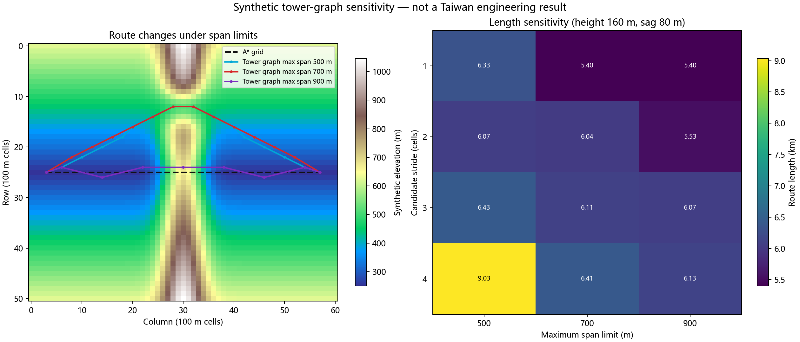

# 合成塔位图参数敏感性分析（2026-10-25）

## 范围

这是**合成地形上的方法敏感性实验**，不是台湾真实线路规划、线路误差评估或工程可行性认证。没有使用历史线路几何、线路网络、台湾站点或外部地形数据。所有塔高、档距、弧垂、净空和候选步长都是为观察算法响应而设置的示例值，未引用具体电压等级规范。

场景为 51×61 栅格，像元间距 100 米；地形用确定性公式构造一条南北向山脊和一处低鞍部。A* 使用坡度软代价，塔位图使用同一代价、20°候选塔位坡度筛选、200 米最小档距，以及解析检查的抛物线弧垂净空。A* 不含塔位/档距/导线模型，所以两者是不同问题模型的对照，不能据路线长短判定哪个在真实工程中更优。

## 结果

- A* 网格基线路线长 **5.40 km**。
- 塔位图在 **44/72** 组参数下找到候选路线；其余 28 组因候选图不可达或剖面净空阈值未通过而无路线。成功组路线长为 **5.40–9.03 km**，中位数 **6.07 km**。
- 候选步长从 1 增至 4 个像元时，可行组数从 **12/18** 降到 **9/18**；成功组的平均路线长度由 **5.71 km** 增至 **7.19 km**。在合成场景里，稀疏采样明显改变图连通性和路线长度。
- 最大档距上限从 500 米增至 900 米时，成功组平均路线长度从 **6.86 km** 降到 **5.72 km**；可行数从 **14/24** 变为 **15/24**。更大档距使部分路线能直接跨越山脊，也改变了筛查结果。
- 固定步长 2、挂点高度 160 米、最大弧垂 80 米时，500/700/900 米上限分别得到 **6.070/6.038/5.531 km** 路线，包含 **15/13/8** 个跨距；最低采样净空为 **63.28/63.28/80.00 米**。这些“通过”仅表示满足本实验设定的简化抛物线筛查。
- 挂点高度与弧垂假设有交互：高度 80 米、弧垂 20 米时有 12 组可行；高度仍为 80 米、弧垂提高到 80 或 140 米时没有组可行。高度 160 米时，弧垂 20/80/140 米分别有 12/12/8 组可行。

实验说明塔位图输出高度依赖候选密度、档距和导线剖面假设；没有真实工程参数时，不能从算法本身确定“最佳”约束，也不能将模拟净空通过解释成工程可建。要开展真实校核，仍需线路电压和导线型号、逐塔坐标/塔型、核定档距、挂点高度、气象荷载下的弧垂/风偏、地面交叉物及许可约束。

## 图表



## 复现

从 `输电线路智能路径规划系统V5.0/` 目录运行：

```powershell
D:\python\python.exe scripts\benchmark_tower_graph_sensitivity.py `
  --output-dir docs\figures\tower_graph_sensitivity_20261025
```

输出包括 73 行参数表（含 1 行 A* 基线）、固定实验参数清单和图：

- `scripts/benchmark_tower_graph_sensitivity.py`
- `docs/figures/tower_graph_sensitivity_20261025/tower_graph_sensitivity.csv`
- `docs/figures/tower_graph_sensitivity_20261025/tower_graph_sensitivity_manifest.json`
- `docs/figures/tower_graph_sensitivity_20261025/tower_graph_sensitivity.png`

本实验没有改变规划器默认路线选择，也不用于当前 12 条真实线路的误差调参。

复跑两次后 CSV、参数清单和图像的 SHA-256 完全一致。文件摘要如下：

| 文件 | SHA-256 |
| --- | --- |
| `scripts/benchmark_tower_graph_sensitivity.py` | `804bd1ee486660abd7e7d43995f4f5dd45c95694fca2ce6799e2bfbb60ef822b` |
| `tower_graph_sensitivity.csv` | `ca58dc5422afbdb95c5c35af45fc6f0189bb20f4b2bc79e59a8f4e03eeb98e8e` |
| `tower_graph_sensitivity_manifest.json` | `8d76fd3c6f38564f7caf4302f87854c698042601f415715bda801b6efa6f10d0` |
| `tower_graph_sensitivity.png` | `6d1568ce6b11a03c64a49b19fc253ae8bc1337ec9cee82299a4c44aa5f72a1db` |
