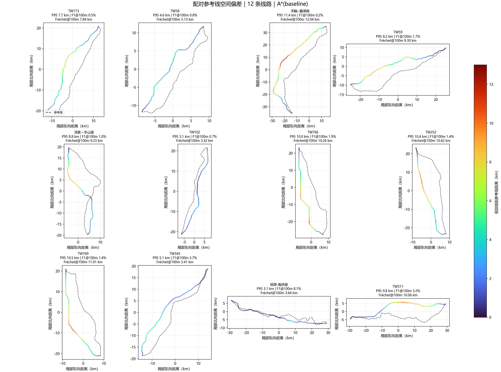

# 官方软约束图层 12 线路 A/B 复测

## 结论

在固定 DEM、OSM、灾害图层、端点和 A* 参数的配对复测中，只新增官方来源的筛查面 GeoJSON 软成本。12/12 对照与处理任务均成功，未使用历史线路作为规划先验；历史线路仅在路线生成后用于事后空间评分。

| 指标 | 无用户软约束 | 加入软约束 | 变化 |
| --- | ---: | ---: | ---: |
| 双向 P95 中位数 | 9.474 km | 8.959 km | 降低 0.515 km |
| F1@100m 中位数 | 1.298% | 1.372% | 增加 0.074 个百分点 |
| 各路线与筛查面相交长度之和 | 47.932 km | 0 km | 降低 47.932 km |
| 路线几何改变案例数 | — | 3/12 | 其余 9 条几何完全相同 |

该变化值得保留为“软风险筛查敏感性”证据，但没有达到用户提出的 100 米级贴合目标。处理组 F1@100m 中位数仅 1.372%，双向 P95 中位数仍约 8.96 km。软约束不能单独解决线路与历史实线的整体空间差异。

## 逐案变化

只有 TW173、TW311、天轮—龙潭线改变了几何。TW173 与保护面相交长度由 30.52 km 降至 0，并且双向 P95 由 22.08 km 降到 7.69 km；TW311 的相交长度由 12.77 km 降至 0，双向 P95 由 9.79 km 变为 9.77 km；天轮—龙潭线的相交长度由 4.64 km 降至 0，双向 P95 由 11.41 km 变为 11.40 km。其他 9 案没有路线变化，因为基线路线没有穿过这些面要素。

这里的相交长度是路线与合并后的 GeoJSON 面要素在 EPSG:3826 下的几何交长，不代表人口暴露、法定禁限建结论或环境影响评估。软成本处理后路线与面要素不再相交，也不能据此断言工程或法规可行。

## 输入和审计边界

- 用户约束文件 `data/official_constraints_20261023.geojson` 包含 140 个面：饮用水水源保护区筛查面 134 个、海洋栖地筛查面 6 个；全部为 `soft`、权重 1.0。元数据要求使用前核实现行法律状态。本实验没有把它们升级为硬禁区。
- DEM 最大边长 4096，实测像元约 34.8–35.2 米；A* 启发权重 1.0；地形、OSM 和灾害输入与基线相同；未启用 VIN、PPO、CostUNet 或塔位图选路。
- 规划端点取自历史测试线路端点，不是核验过的变电站接入点；没有塔位、跨距、弧垂、导线净空和许可数据。因此本结果是固定端点走廊筛查，不是站间工程可行性认定。
- 两次运行 Git 提交号不同，但逐文件运行时源码哈希核对后，差异恰好只有未启用的 `experimental_tower_graph.py`；两侧均关闭塔位图和塔位图选路，其余运行源码、运行环境、端点和非处理输入哈希一致。旧/新文件哈希与核验记录见配对 JSON。
- 当前官方最小统计区目录没有边界文件。历史镜像的坐标精度、边界版本和几何有效性不足，未接入规划代价。

## 结果图

下图按 20 米采样显示处理组规划线到参考线的空间偏差。颜色表示到参考线的偏移距离；虚线为参考线。它展示了当前仍存在的公里级整体偏差。



另有 12 案软约束前后路线与筛查面的叠加图：[查看 A/B 路线与筛查面](evidence/official_soft_constraints_ab_4096_20261025/comparison/constraint_route_ab.png)。

## 可复现材料

配对 CSV、JSON、A/B 路线图、处理组误差图、两组 provenance/summary/metrics 以及 24 条导出路线 GeoJSON 均保存在 `docs/evidence/official_soft_constraints_ab_4096_20261025/`。`evidence_manifest.json` 为随附证据文件记录大小与 SHA-256；DEM、OSM 缓存、灾害瓦片和约束 GeoJSON 仍按数据管理规则保留在本地 `data/`，运行清单中记录其路径与哈希。

处理组命令：

```powershell
D:\python\python.exe -m transmission_path_planner `
  --dem data\taiwan_dem_35m_georef_fixed.tif `
  --osm-cache-dir D:\大创\V5_final\data\downloaded `
  --real-cases-csv D:\大创\data\real_cases_tw\real_cases.csv `
  --real-dir D:\大创\data\real_cases_tw `
  --constraint-geojson data\official_constraints_20261023.geojson `
  --out-dir outputs\official_soft_constraints_ab_20261025 `
  --no-vin --no-ppp --max-side 4096
```

配对检查与图件生成脚本：`tools/compare_constraint_ab_runs.py` 和 `tools/plot_route_error_maps.py`。本次配对比较脚本回归测试 4 项通过；配对门禁与制图命令退出码均为 0。
