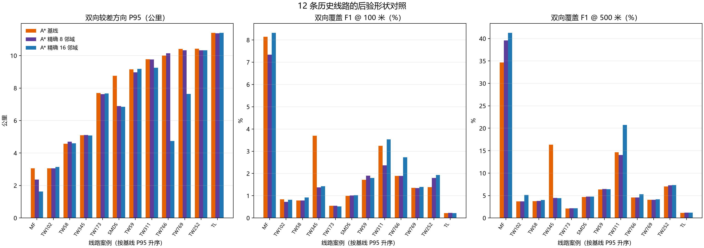
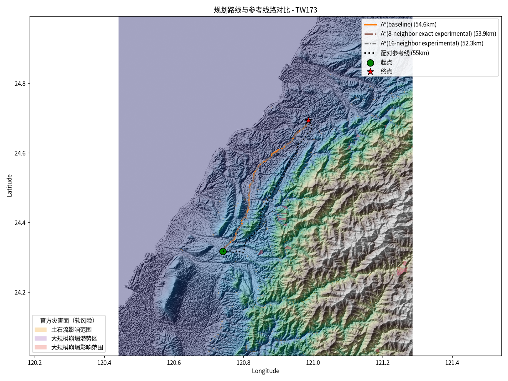
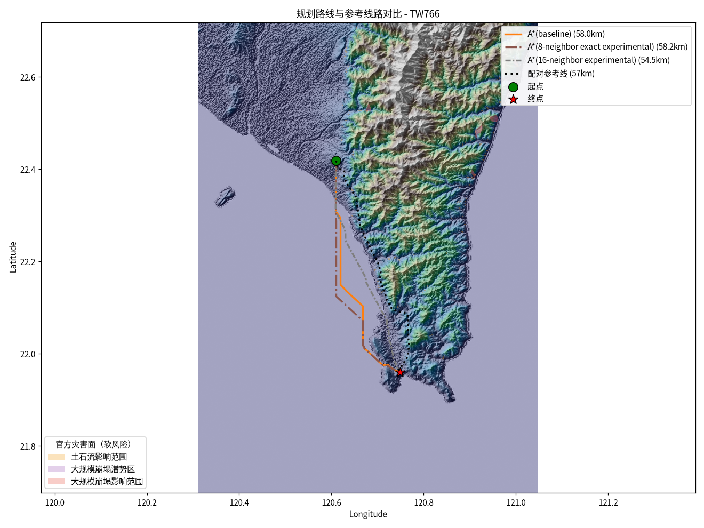
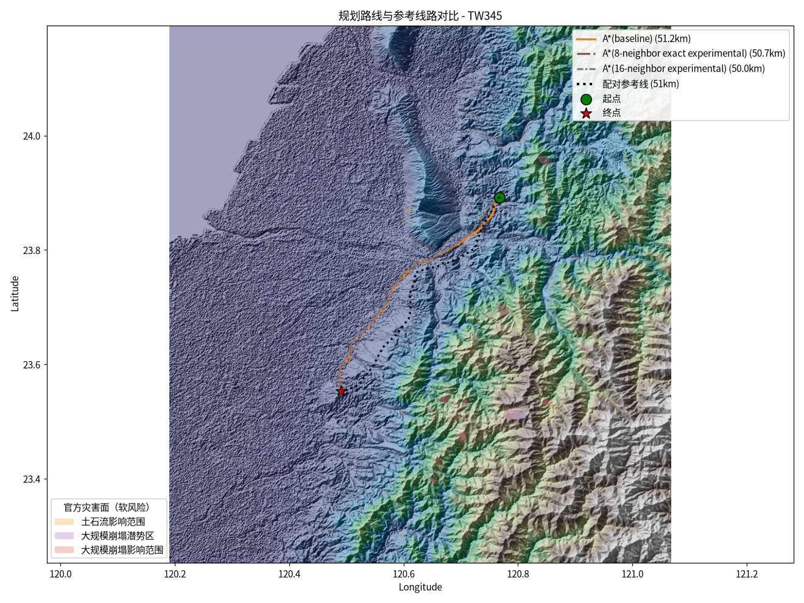

# 搜索邻域 12 线路后验对照与数据更新

## 本轮结论

旧代码批次合并后覆盖 12 个唯一案例：前 4 案来自 `outputs/server_search_variants_12cases_20261025_retry1/`，其余 8 案来自服务器目录 `search_variants_remaining8_20261026/`。新 8 案运行摘要为 8/8 完成，无失败、无无路案例；两批的线路相似度指标版本均为 6、采样间隔均为 20 米。每案可用 4 种算法记录；旧 JSON 额外的“最终路线”键未计入算法比较。

这仍是历史线路的后验形状诊断，不是经过核验的变电站站间规划准确度。输入端点仍取自历史折线端点，尚未替换为变电站线路侧接入点。

## 12 案逐方法中位数

数值先按每案计算，再报告 12 案中位数。P95、Fréchet 与线路长度差越低越好；覆盖率 F1 越高越好。

| 搜索方法 | 双向 P95 | F1@100 米 | F1@500 米 | 离散 Fréchet | 长度差 |
| --- | ---: | ---: | ---: | ---: | ---: |
| A* 基线 | 8.959 km | 1.372% | 4.611% | 9.264 km | 1.343% |
| A* 精确 8 邻域 | 8.299 km | 1.360% | 4.494% | 8.496 km | 1.843% |
| A* 精确 16 邻域 | 7.245 km | 1.413% | 4.943% | 7.564 km | 4.823% |
| Theta* | 6.991 km | 1.363% | 4.944% | 7.383 km | 5.800% |

这些总体中位数会掩盖线路间差异。对于目标函数和积分方式完全一致的**精确 8 邻域与精确 16 邻域**配对比较：16 邻域的 P95 在 8/12 案更低，配对 P95 差中位数为 −38 米；F1@100 米在 9/12 案更高，配对中位增量为 0.073 个百分点；离散 Fréchet 在 9/12 案更低，配对差中位数为 −162 米。整体提升幅度有限，并非每案、每项指标都改善。

16 邻域搜索将 8 邻域动作集合扩展为包含骑士步的 16 个偏移；两者用同一精确分段栅格积分、硬约束、端点处理、平滑和复核，因而这是本批最干净的邻域控制对照。与生产 A* 基线的差异不能单独归因于邻域：生产 A* 使用梯形边成本并另加软地面坡度惩罚，实验 8/16 邻域则使用精确分段积分且关闭该软惩罚。Theta* 搜索空间也不同，且运行耗时高，不应与 8/16 邻域当作只变一个因素的对照。

## 当前代码复测（2026-10-26）

当前代码批次已完成 12/12 条，失败 0、无路 0；生成生产 A*、精确 8 邻域和精确 16 邻域三种结果。服务器任务耗时 3251.6 秒，约使用 1 个 CPU 核与 3.75 GB RSS；没有使用 GPU。原始产物在 `outputs/current_tie_break_12cases_20261026/output/`，包含 `run_summary.json`、`run_provenance.json`、`real_comparison_metrics.json`、12 张线路图和 GeoJSON。

| 方法 | 双向 P95 | F1@100 米 | F1@500 米 | 离散 Fréchet | 长度差 | 中位规划耗时 |
| --- | ---: | ---: | ---: | ---: | ---: | ---: |
| A* 基线 | 8.959 km | 1.372% | 4.611% | 9.264 km | 1.343% | 21.9 秒 |
| A* 精确 8 邻域 | 8.299 km | 1.360% | 4.525% | 8.496 km | 1.896% | 35.4 秒 |
| A* 精确 16 邻域 | 7.245 km | 1.413% | 4.943% | 7.564 km | 4.823% | 69.4 秒 |

精确 16 相对精确 8：双向 P95 在 8/12 条更低，配对差中位数 −37.9 米；F1@100 和 F1@500 各在 9/12 条更高，配对增量中位数分别约 +0.073 和 +0.065 个百分点；离散 Fréchet 在 9/12 条更低，配对差中位数 −161.5 米。16 邻域的中位规划耗时约为 8 邻域的 2 倍。优势存在但幅度有限，且因目标函数不同，不能据此替换生产路线：这组 8/16 实验关闭生产版软坡度罚项，仍使用同一精确积分代价和硬约束。

按目前保存的旧批次 JSON 做数值对照，生产 A* 与 16 邻域五项几何指标逐案一致；精确 8 邻域只在 TW766、TW769 两案有变化，其他 10 案不变。但旧批次缺少完整的源码和输入清单，不能据此证明两次运行的所有环境与数据完全相同。词典序平手处理没有带来稳定的大幅改善，因此不应把这次变化描述成路线精度升级。

这次运行的 `run_provenance.json` 显示 `source.available=false`，原因是服务器运行目录是源码复制件而非 Git 仓库。该复制件在任务启动时来自本地提交 `af920e22b8b140f525f78dca47e67bd5d99586f3`；其规划器源码树 Git 对象 ID 为 `3efe5de0c68cae720896d406ac724ab514ad6044`。提交哈希可复核，但服务器运行清单无法独立证明复制件与该对象逐文件相同，故将本轮作为可定位源码版本、但仍有运行源清单局限的复测。

## 可复现性与解释边界

- 前 4 案缺少运行摘要和来源清单；后 8 案的来源元数据记录服务器工作目录不是 Git 仓库，无法证明源码版本或每个规划输入与前 4 案完全一致。因此合并结果适合探索性诊断，不构成可审计的严格 12 案复现实验。
- 规划器运行时加载了 `official_constraints_20261023.geojson`，但其中约束没有独立核验为法定硬禁区；“已配置硬约束零违规”不能解释为工程审查通过。
- 本批未启用 WorldPop、土地利用惩罚权重为 0，也未运行塔位图、档距、弧垂或导线净空校核。12 案不能证明工程可建性。
- 线路几何只在规划输出冻结后用于指标计算；不得用这些分数挑选路线权重或回调历史线路。
- 当前代码复测已完成；精确邻域仍只是实验候选，不参与默认最终选路。若要评估软坡度罚项与 16 邻域的组合，应另做共享边成本公式的 8/16 配对复测。

## 新发现的地形数据源

内政部于 2026-09-30 上架 2026 年版全台 20 米 DTM 索引，授权为政府资料开放授权条款第 1 版；索引说明为 TWD97（N、E、H），制作方法为航空摄影测量，且各图幅制作年度可能不同。“2026 年版”不等于每个图幅都在 2026 年测绘。官方 20 米资料接口为开放服务；官方页面说明 1 米服务属于受限公务资料。[2026 年版数据集](https://data.gov.tw/dataset/178729)、[官方 CSV 索引](https://opdadm.moi.gov.tw/api/v1/no-auth/resource/api/dataset/B6219841-E247-4743-958D-77FB61067092/resource/D788C60B-33CB-4A84-A438-EC6E8B7060F1/download)、[DTM 服务说明](https://dtm.moi.gov.tw/)、[官方 API 文件](https://dtm-openapi.colife.org.tw/swagger/v1/swagger.json)

已取得数据集提供的 CSV 索引，其中列出分幅与整岛 2026 版压缩包链接；但在本机及规划服务器测试文件站点时，DNS 无法解析，使用解析出的站点 IP 请求仍返回 HTTP 403。没有官方资料表明 ZIP 必须登录；该 403 只说明当前请求被拒，不能推断数据受限。故目前只确认索引与服务存在，没有把 2026 DTM 下载或写入规划器。官方公开 API 的产品枚举目前列到 2019 年版，不能据此声称 API 已提供 2026 地形栅格。数据坐标系统字段也不足以确认垂直基准；在取得文件及头信息前不拿它替换现用 DEM。

### 补充核查：全台 6 米地形图层

农村水保署 BigGIS 官方公告确认存在由 2016–2023 年高程数据镶嵌生成的全台 H.O.S.T/CSMap 底图，提供 6 米和 20 米显示版本；其开放 WMTS 目录把该接口列为图砖服务。中研院 GIS 专题中心列出 6 米图层的 WMTS/XYZ 访问方式与 Level 1–14 缩放范围。[BigGIS 图资公告](https://gis.ardswc.gov.tw/news/map/325)、[BigGIS WMTS 服务目录](https://gis.ardswc.gov.tw/api-doc)、[中研院图层说明](https://gis.rchss.sinica.edu.tw/mapclub_20260909/)

这些 6 米服务是 JPEG 渲染图砖，不是可读取高程值的原始 DEM；更细的显示纹理不能代替数值高程精度。因此当前只把它列作人工地形视觉核对候选，不接入 A* 或坡度/弧垂计算。BigGIS 说明其底图由 5 米与 20 米 DTM 加值制作，但没有在本次核查中找到可公开下载、带完整元数据的 6 米原始高程栅格。[BigGIS 系统简介](https://gis.ardswc.gov.tw/introduce)

内政部图资供应平台说明 20 米 DTM 为开放资料；5 米及以下资料通过机关申请流程提供，并标为一般公务机密。[内政部 DTM/HyDEM 供应平台](https://supply2.colife.org.tw/)。所以这轮未发现同时满足全台覆盖、公开可取得、可直接进入规划器的 6 米数值 DEM。现阶段继续使用已验证可读的 20 米 DTM；若以后取得许可明确的高分辨率数值格网，再核对制作年度、投影、垂直基准、NoData 和覆盖后做同参数 A/B。

## 下一步

1. 新增的 `--experimental-astar-16-shared-objective` 已通过 12 项目标单元测试、小网格 Dijkstra 对照和生产 8 邻域代价等价检查；它使用同一代价栅格精确积分和生产端点坡度公式。16 邻域长边的端点坡度罚项可能掩盖边内正负高程变化，因此仅作为图搜索目标对照，不称为连续地形坡度成本，也不参与最终选路。下一轮在 12 条上验证该配对组，并测量完整耗时与内存。
2. 暂用已验证可读的 20 米 DTM；2026 版官方 ZIP 当前未能取得，BigGIS 6 米层只作人工视觉检查。若之后取得可读的高分辨率数值栅格，先核验覆盖、分辨率、NoData、坐标与高程基准，再单独做地形 A/B。
3. 在获得核验后的站端接入坐标、输电电压等级、塔型/档距、导线荷载与净空规则前，把结果限定为固定端点走廊筛查，不报告工程规划通过。
