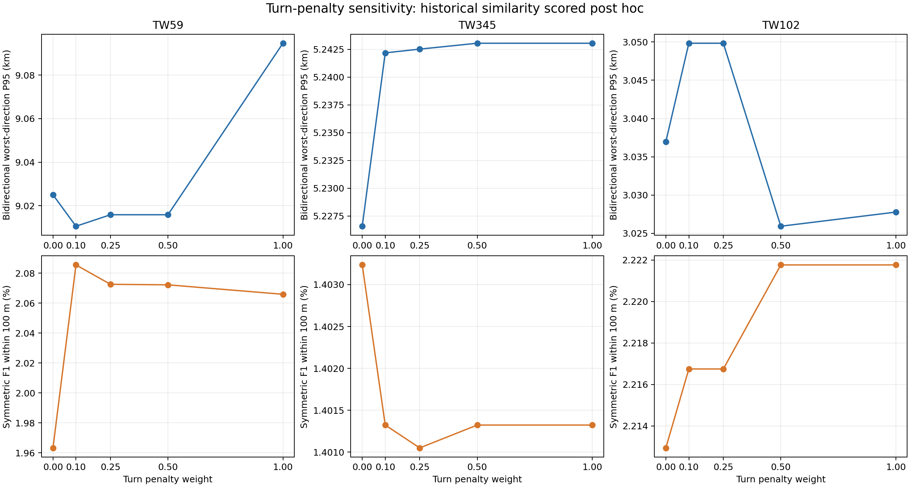
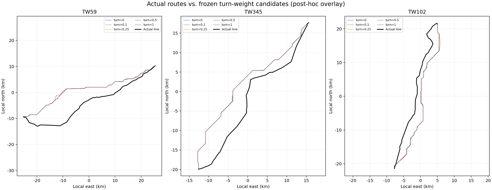

# 大创项目结题报告草稿

## 项目与结论

立项申请表所载项目名称为“基于IPSO-SA与无人机协同的复杂山区高空输电线路路径规划研究”，计划周期为 2026 年 3 月至 2027 年 8 月。本报告以立项表、执行计划和当前 V5.0 软件及实验记录为依据；负责人、成员、指导教师、立项编号、经费与最终验收日期仍按校内记录复核。

本项目形成了一个可运行的输电线路走廊筛查软件原型，主要功能是以固定起终点、地形与约束图层进行确定性 A* 候选路线规划，并提供路线导出、约束状态和事后评估工具。当前证据不支持“机器学习融合算法、无人机实时扫描闭环或历史线路 100 米精度目标已完成”的表述。项目与原计划存在实质性调整，是否满足学校结项要求须由指导教师和学院根据立项任务书确认。

## 原计划与实际交付

| 原计划内容 | 当前可核实交付 | 结题表述边界 |
|---|---|---|
| GNN/Transformer 与 PPO/DQN 纯机器学习路线规划 | 软件包有可选 VIN/PPO 诊断代码；无可核验的训练集、训练记录或稳定部署模型 | 不写成已完成或优于启发式的主规划算法 |
| WOA/GWO/SSA、IPSO-SA 等算法对比 | 当前主体为确定性 A*；已完成地形权重、搜索与路径形态敏感性试验 | 不声称完成原计划算法组 |
| 无人机 S 型覆盖扫描与在线数据融合 | 本结题证据中没有完整的无人机采集—地图更新—重规划验收链路 | 不列为已验收成果；需补充其他开发组的可运行代码、演示和测试证据后再写 |
| 动态扫描和融合优化闭环 | 当前软件面向静态 DEM/约束图层离线规划 | 说明为当前范围未实现 |
| 真实线路贴合精度 | 完成候选冻结后的 100 m 及双向 P95 评价 | 当前测试远未达到 100 m 目标，须如实报告 |
| 站点间规划 | 软件已支持站点台账、站间任务表及端点核验声明 | 实验端点尚未全部核实为站端接入点，当前样例不等于正式站间工程验证 |

建议结项前由导师确认立项计划变更及可接受的验收范围。若必须按原计划逐项验收，应补齐未交付内容及相应证据，不能以本报告文字替代。

## 软件与研究工作

V5.0 包含 23 个 Python 文件、9,602 行原始源码。主流程读取 DEM 与可选环境图层，按硬约束建立可行掩膜，再由 A* 搜索累计代价较低的路径。地形坡度、粗糙度、OSM 建筑代理和官方灾害图层用于路线筛查；人口代价默认关闭。历史线路只在候选冻结后用于研究性对比，不参与规划、参数挑选或选路。

软件支持站点表与站间任务表，并要求正式端点提供线路接入点核验声明、来源和凭证字段。程序检查字段是否填写，不验证来源和凭证的真实性。实验使用的历史线端点不应混写成已核验站点。

## 实验结果

### 地形代价权重消融

3 个固定端点案例、6 种坡度/地面坡度权重组合，共 18 次成功规划。候选冻结后进行历史线对比：双向较差方向 P95 最小 3.037 km、中位数 5.215 km、最大 9.025 km；100 m 对称 F1 平均 1.947%。0/18 条路线达到 P95≤100 m。权重调整能够改变地表坡度暴露，但没有稳定消除公里级空间偏移。

### 转弯权重消融

3 个案例、4 个非零权重及 3 条零权重基线，共 15 条冻结候选；新增 12 次 CPU 运行均成功，累计 2,461.6 秒，未使用 GPU。双向较差方向 P95 范围 3.026–9.095 km，中位数 5.243 km；100 m 对称 F1 范围 1.401%–2.222%；0/15 条达到 P95≤100 m。该参数同时作用于 A* 搜索和路径平滑，因此结果表示联合变化，不是 A* 单项消融。

P95 采用双向采样，并取两个方向中较差的 P95；F1@100 m 为双向 100 m 容差覆盖率的调和平均。约束零违规只针对已配置的图层与程序检查，不代表获得工程许可或可建性认证。样本数和数据覆盖限制了统计外推。

## 数据、可复现性与风险控制

主要实验使用约 35 m DEM、陆域掩膜、官方灾害图层、OSM 建筑/土地利用缓存及显式约束 GeoJSON；人口层未参与上述两轮实验。候选冻结记录、输入与代码哈希、评分 CSV、图表及经过脱敏的运行摘要随项目文档保存。真实线路几何未进入候选生成过程。

仍需加强站端接入点与电路拓扑核验、OSM 建筑/居民点覆盖评估、官方保护区/工程走廊约束、真实杆塔档距和导线力学模型。实验性塔位图使用简化高度/弧垂筛查，不可作为工程校核。

## 成果清单

- 输电线路智能路径规划系统 V5.0 源码与运行说明。
- 软件说明书、源码鉴别材料和软著申请字段/资料清单草稿。
- 18 组地形代价权重消融及 15 条转弯权重候选事后评估记录。
- 真实路线叠加图、双向空间误差指标、输入与候选哈希记录。

本报告不替代学校指定结题表、导师意见、项目经费表、成员签字或现场答辩材料。项目名称、编号、申请人、日期和贡献分工须按学校原始文件核对。
